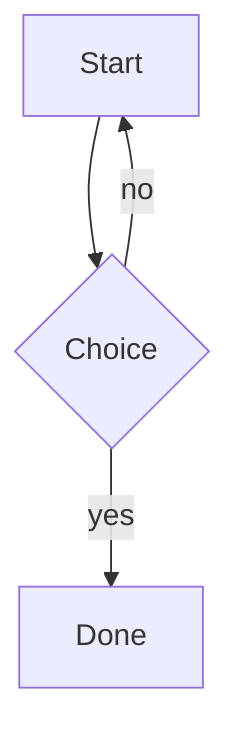

# mdview rendering check

A paragraph that wraps across
several source lines and contains a [link](https://example.com/a(b)),
an autolink <https://example.org/x?q=1&y=2>, a bare URL https://example.com/thing.
plus **bold**, *italic*, ***both***, ~~struck~~, `code`, <kbd>Ctrl</kbd>+<kbd>C</kbd>.

H~2~O and E=mc^2^ stay literal, snake_case_name too, and 5*6*78 emphasises.

Entities: &auml; &copy; &nbsp; &#169; &#x2603; &HilbertSpace; and a bare & ampersand.

## Lists

- tight item one
- item two with a nested list
  - nested a
  - nested b
- item three

1. ordered one
2. ordered two
   1. nested ordered
   2. nested ordered

- [x] task done
- [ ] task pending

Loose list below:

- first paragraph of the item

  second paragraph of the same item

- second item

Illustrations step back from the definitions they illustrate:

- A definition keeps the ink it is being read for.
- Example: an illustration of it does not.
- Examples:
  - an item that is only the signpost introduces this list, so it keeps its ink

A definition with its illustration bolted on the end. Examples: and the
illustration follows in the muted ink, because the writer put the signpost
there.

## Quotations and breaks

> A blockquote with a
> lazy continuation.
>
> > And a nested quote.

Hard break here:  
after two spaces.

## Callouts

> [!NOTE]
> GitHub alert syntax, styled after render so the markdown output stays plain.

> [!TIP]
> Click a downscaled image or a diagram to enlarge it; Escape closes it.

> [!IMPORTANT]
> A callout keeps its ordinary blockquote shape anywhere mdview is not running.

> [!WARNING]
> Long documents get a Contents disclosure below 1280px, where the margin
> outline has no room.

> [!CAUTION]
> Nothing here changes what the CommonMark suite scores.

## Definition lists

A list in which every item leads with a short bold term and a colon is set as rows with an
aligned column, because that is what it is — a specification, not a bulleted list. One
ordinary bullet anywhere and the whole list stays ordinary:

*   **Routing:** Directing incoming requests to the correct microservice.
*   **Aggregation & Composition:** Calling multiple microservices at once and combining
    their responses into a single payload for the front-end.
*   **Cross-Cutting Concerns:** Handling authentication, authorization, rate limiting,
    caching, and logging so individual microservices do not have to.

Below 768px the terms stop being a column and the item reads as one sentence again, which
is the text exactly as it was written.

## Table

| Feature      | State   | Notes            |
| :----------- | :-----: | ---------------: |
| headings     | done    | ATX + setext     |
| tables       | done    | alignment works  |
| html         | partial | `allowlist`      |

Feature | State | Notes
--- | :-: | ---:
no outer pipes | done | ok

## Wide tables

A table too wide for its card is given its fitting move first: the header row is allowed
to wrap, because a two-line header costs less than a hidden column. This one fits once
its headers wrap, so it never scrolls and never casts an edge shadow.

| Learning outcome | Performance criterion | Type of learning evidence | Assessment instrument | Checkpoint | Weight |
| --- | --- | --- | --- | --- | --- |
| LO1 | Apply the model to a case | Written report | Rubric, three levels | Week 6 | 20% |
| LO2 | Defend a design decision | Oral defence | Panel of two markers | Week 10 | 30% |

An assessment grid as wide as its columns, which no amount of wrapping can save, so it
keeps its scroll — and now says so, with a soft shadow at each edge that goes away at the
end it points at.

| Outcome | Weight | Week | Format | Duration | Marked by | Moderated | Checkpoint | Resit |
| --- | --- | --- | --- | --- | --- | --- | --- | --- |
| LO1 | 20% | 6 | Report | 48 hours | Coordinator | Internal | Yes | July |
| LO2 | 30% | 10 | Defence | 30 minutes | Panel of two | External | No | July |
| LO3 | 25% | 12 | Project | 3 weeks | Coordinator | Internal | Yes | September |

The paths in this one are long, but they break at the slash, so it still fits:

| Artifact | Path | Produced by | Consumed by |
| --- | --- | --- | --- |
| manifest | `var/build/artifacts/2026-09-29/course-catalogue.manifest.ndjson` | review-console | publish-service |
| index | `var/build/artifacts/2026-09-29/course-catalogue.index.sqlite3` | review-console | publish-service |

That grid's first column is pinned while the rest scrolls past, because that column is the
key to the rows. This one is not: a first column of unbreakable tokens is content, and
pinning it would cover far more than it reveals, so it scrolls with everything else.

| Integrity hash | Asset | Version | Licence |
| --- | --- | --- | --- |
| `sha512-8b4f0a2c9e1d7b3f5a6c8e0d2f4b6a8c0e2d4f6a8b0c2e4d6f8a0b2c4d6e8f0a` | mermaid.min.js | 11.4.1 | MIT |
| `sha512-1c3e5a7b9d0f2e4c6a8b0d2f4e6c8a0b2d4f6e8c0a2b4d6f8e0c2a4b6d8f0e2c` | icon.svg | 1.5.4 | MIT |

## Label/value sheets

A two-column table whose left column is nothing but short labels is a specification
sheet, not a data grid: the labels step back, the figures line up in a column, the rows
tighten, and the sheet shrinks to its content instead of stretching across the measure.
Like every treatment below, it changes nothing in the markup — the values are still the
values, in the order they were written.

| Field | Value |
| --- | --- |
| Faculty | Engineering |
| Program | Systems Engineering |
| Semester | VII |
| Course Code | 1157007 |
| Direct Contact Hours (HAD) | 48 |
| Independent Work Hours (HTI) | 96 |
| Total Student Academic Work Hours (HAD + HTI) | 144 |

A third column makes it a grid, and a grid keeps its stripes and its full width:

| Feature | State | Notes |
| --- | --- | --- |
| headings | done | ATX and setext |
| tables | done | alignment works |
| sheets | new | two columns of labels |

Below 640px the labels wrap again, because a nowrap column inside a narrow page is a
horizontal scrollbar rather than a column.

## Labels, source notes and references

A paragraph that is nothing but a short bold label ending in a colon is a field label, so
it names the block it introduces instead of competing with it:

**Topics and subtopics:**

*   Service-oriented architecture (SOA)
    *   Service orientation
    *   Systems integration
*   Web services

A paragraph that is nothing but a bracketed note is the transcriber talking, and reads as
a hole in the source rather than as a claim the document makes:

[Illegible/corrupted character sequence in the original PDF omitted.]

A list whose items are entries rather than points — each one a sentence with its year in
the back half — hangs, so the eye can find where the next entry starts:

*   S. Newman, *Building Microservices*. O'Reilly Media, Inc., 2015.
*   E. Evans, *Domain-Driven Design*. Addison Wesley, 2004.
*   V. Vernon, *Implementing Domain-Driven Design*. Addison Wesley, 2013.
*   Eric Newcomer and Greg Lomow, *Understanding SOA with Web Services*, Addison-Wesley, 2004.
*   *Web Services: Principles and Technology* by Michael P. Papazoglou. Pearson/Prentice Hall, 2007.

## Notes and citations

A citation becomes a raised number that links to a note at the end of the document, and
the note carries a link back to where you were reading. The number follows the order the
reader meets the citations in, not the order the definitions were written in[^why], so the
note defined last is note 1 and the one defined first[^first] is note 2.

Numbering by citation is what lets a sentence be moved without the apparatus being
renumbered[^why]. A note cited twice is one entry with a back-link for each citation[^twice],
and a sentence that wraps onto the next source line without indentation stays in the
note[^first] — a wrapped sentence is a wrapped sentence.

A note holds as much as any other block: several paragraphs, a list, a fence. Everything
indented four spaces under the definition belongs to it[^long].

Definitions are written one after another, which is why the line that opens one ends the
one before it. Two things are left as typed rather than invented: a citation with no
definition in the document stays literal[^nowhere], and a definition nobody cites — the
`[^ghost]` below — is not a note, so it is not rendered.

[^why]: Numbering by citation is what lets a sentence be moved, or a note added in the
    middle, without the whole apparatus being renumbered.
[^first]: Defined first but cited second, and wrapped onto the next
source line without any indentation, which is where a wrapped sentence belongs.
[^twice]: Cited twice, so it lists both places it was called from.
[^long]: The first paragraph is where the back-link goes, so the link is always in the
    same place relative to the note.

    Additional paragraphs are indented by four spaces, and so are lists:

    *   the first item
    *   the second item

    ```
    a fence is indented too, and stays a fence
    ```

[^ghost]: Nothing cites this, so it is dropped rather than numbered.

A list that merely mentions a year stays a list of points:

*   Microservices arrived around 2014 and changed how services are deployed.
*   The 2017 papers above are the ones the reader keeps coming back to.
*   Nothing else in this bullet list looks like a citation at all.

## Code

```python
def greet(name: str) -> str:
    return f"hello {name}  # not a comment"
```

    indented code block
      with extra indentation



## Heading depths and rules

Setext heading
==============

A paragraph that serves as a setext sub-heading
-----------------------------------------------

#### Fourth level heading

##### Fifth level heading

###### Sixth level heading

A thematic break follows.

---

And a paragraph after it, plus images (a bare markdown one and a sized raw-HTML one):


<div align="center"></div>

## Raw HTML (allowlist)

<div align="center">

**Centred** content with an attribute-filtered tag:

<span style="color:#0369a1">styled span</span> and <mark>highlight</mark> and
<sub>sub</sub><sup>sup</sup>.

</div>

<details>
<summary>Click to expand</summary>

Markdown inside details after a blank line.

</details>

An escaped tag: <script>alert(1)</script> and a dropped attribute:
<a href="#" onclick="boom()">safe link</a>.

## Anchors

### Repeated

### Repeated

Jump target: [back to top](#mdview-rendering-check) · [same](#repeated-1)

## The word you double-click

Double-click any word in this paragraph to get its definition in a card: a
double-click selects the word, the card is anchored to it, and the card can be
closed with Escape, a click elsewhere, or by scrolling the word away.

The words inside a code span are left alone, because `kernel_panic` is an
identifier and not a word: [inline code](kitchen-sink.md) and code in a fence
below are both skipped.

```text
double_click_me_is_not_a_word
```

A drag across a phrase asks about the phrase, not just the word it started on.

A definition is prose, and prose hides words: double-click a word *inside* the
card and the card answers about that word too, keeping its place under the word
you first asked about, with a small arrow at the top left to go back to it. The
words in the card's own furniture — where it came from, the pointers, the link at
the bottom — are not part of any definition and are left alone.

`struck` is the interesting one to try: the dictionary's only entry for it is a
surname, so the card asks about *strike* instead and says so. A word that has
more than one part of speech gets a pointer for each — noun, verb, adjective,
adverb — and pressing one shows that part's meanings without scrolling for them.
Opening the whole list writes each part of speech once, as a heading over the
meanings it governs, rather than stamping it on every line.

A phrasal verb is a phrase, and the phrase is what the dictionary files under, so
double-clicking the verb in a sentence like the build ended up taking three hours
asks about end up and says so — the head still reads the word you clicked. Drag
across came up with an idea and it is asked as one phrase, because the dictionary
has no entry for either half on its own. The particle has to be there in the
text: back, over and in are ordinary words on their own, so a card for one of
them is a card for that word.
