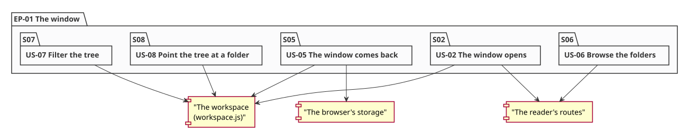
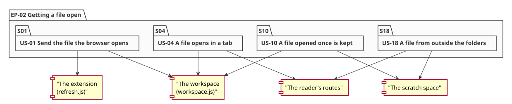
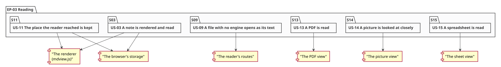
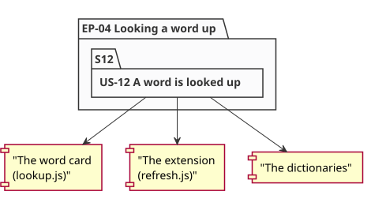
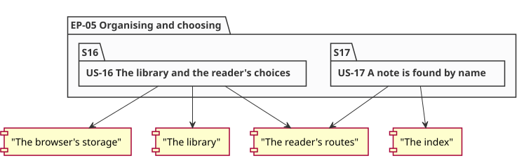
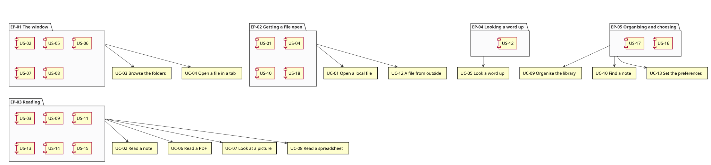

# The epics

A use case is a goal. A story is a slice of one. An **epic** is a body of
work: a group of stories that, together, deliver one outcome, and that a
reader would recognise as a thing rather than as a list of pieces.

The chain the method follows becomes:

```
use case (a goal)  →  epic (a body of work)  →  story (a slice)  →  task
```

The epics below are the bodies of work this system needs, in the order they
were delivered. Each one names the outcome it delivers, the use cases it
serves, the stories that make it up, and the drawing of its shape — the
stories it holds and the parts of the system they touch.

The stories are in [stories.md](stories.md) and the order they were pulled in
is in [backlog.md](backlog.md).

---

## EP-01 — The window

| | |
|---|---|
| **Outcome** | The reader opens a window that shows where they are and what they have open, and can move around it without losing their place |
| **Use cases** | UC-03, UC-04 |
| **Stories** | US-02, US-05, US-06, US-07, US-08 |
| **State** | done |

The window is the thing the reader looks at, and it is where the tree, the
tabs and the filters live. It is also the part of the reader that remembers:
the folder the tree stands in, the files that are open and the filters that
are set are all kept in the browser's storage, so the window comes back as it
was left (F-10, S-6).



*The stories the epic holds, and the parts they touch: the workspace, the
reader's routes and the browser's storage.*

## EP-02 — Getting a file open

| | |
|---|---|
| **Outcome** | A file the reader names — in the browser, on the disk, or from a folder the reader does not have yet — opens in a tab |
| **Use cases** | UC-01, UC-04, UC-12 |
| **Stories** | US-01, US-04, US-10, US-18 |
| **State** | done |

Everything that ends with a file in a tab: the extension sending the file
the browser opened, the tree opening one, a file dropped on the window, and
a file from outside the reader's folders, which is offered back with the
folder that holds it (F-1, F-9, F-26).



*The stories the epic holds, and the parts they touch: the extension, the
workspace, the reader's routes and the scratch space.*

## EP-03 — Reading

| | |
|---|---|
| **Outcome** | Every file the reader opens is readable — a note as a note, a PDF as pages, a picture as pixels, a spreadsheet as a grid — and the reader comes back to the words they were at |
| **Use cases** | UC-02, UC-06, UC-07, UC-08 |
| **Stories** | US-03, US-09, US-11, US-13, US-14, US-15 |
| **State** | done |

The reading itself, in all its forms, and the place in it: the renderer
measured against the corpus, the PDF's boxes and paints, the picture at its
own pixels, the grid, and the place kept as a page and a fraction of a page
rather than a scroll offset (F-3, F-4, F-19, F-22).



*The stories the epic holds, and the parts they touch: the renderer, the
PDF view, the picture view, the sheet view, the reader's routes and the
browser's storage.*

## EP-04 — Looking a word up

| | |
|---|---|
| **Outcome** | A word can be looked up wherever the reader finds it — in a note, in a PDF, on any page of the browser |
| **Use cases** | UC-05 |
| **Stories** | US-12 |
| **State** | done |

One story, and the largest single piece of work in the reader: the card that
appears where the word is, the background script that asks the dictionary
because a page's own fetch is subject to that page's rules, the three hosts
that are ever asked, and the tab that takes the card's place where a card
cannot live (F-11, F-14, S-2, S-3).



*The story the epic holds, and the parts it touches: the card, the
extension's background script and the dictionaries.*

## EP-05 — Organising and choosing

| | |
|---|---|
| **Outcome** | The reader can find their notes, keep them in order, and have the reader look the way they want it |
| **Use cases** | UC-09, UC-10, UC-13 |
| **Stories** | US-16, US-17 |
| **State** | done |

The library's changes — and the changes are the only writes the reader makes,
so they carry the origin and the token (S-1, D5) — the search, which says
which answer it gave (F-24), and the reader's own choices, which live in
the browser and nowhere else (F-27).



*The stories the epic holds, and the parts they touch: the library, the
reader's routes, the browser's storage and the index.*

---

## The map



*The epics, the stories inside them, and the use cases they serve. The map is
the one drawing that says what the work was, and it is the first thing to
look at when the next body of work has to be placed.*
