# The stories

A use case is a goal; a story is a slice of it that can be delivered and
estimated; a task is the work that lands. Each use case above yields several
stories, because the happy path is usually one of them and each alternative or
exception is another.

Each story carries its acceptance criteria as testable statements, and the rule
each criterion enforces is cited. The size scale is **S** = half a day, **M** =
two days, **L** = a week, for one person who knows the code.

The order the stories are delivered in is in [backlog.md](backlog.md).

**The drawing of each story**, where one helps, is in
[../model/](../model/): a sequence for a story that is a conversation, an
activity for a story that is a flow, a communication for a story that is about
who talks to whom, and a state machine for a story about a thing's states.
The model names the story each diagram belongs to.

---

### US-01 — Send the file the browser opens

**As a** reader **I want** the file I opened in the browser to come up in the
reader's window **so that** I do not have to find it again.

* **Epic**: EP-02 · **Use case**: UC-01 · **Requirements**: RF-01, RNF-04
* **Size**: S
* **Acceptance criteria**
  1. A tab whose address is a `file://` URL of a kind the reader reads is sent to the reader's workspace, with the file's path named in the address (F-1).
  2. A tab that is already at the reader's address is not sent again (F-1).
  3. A file of a kind the browser will not show is not sent: the browser downloads it, and there is nothing to send (F-1).
  4. The file is on the screen in the workspace within 1.5 s of the tab's address being written (RNF-04).

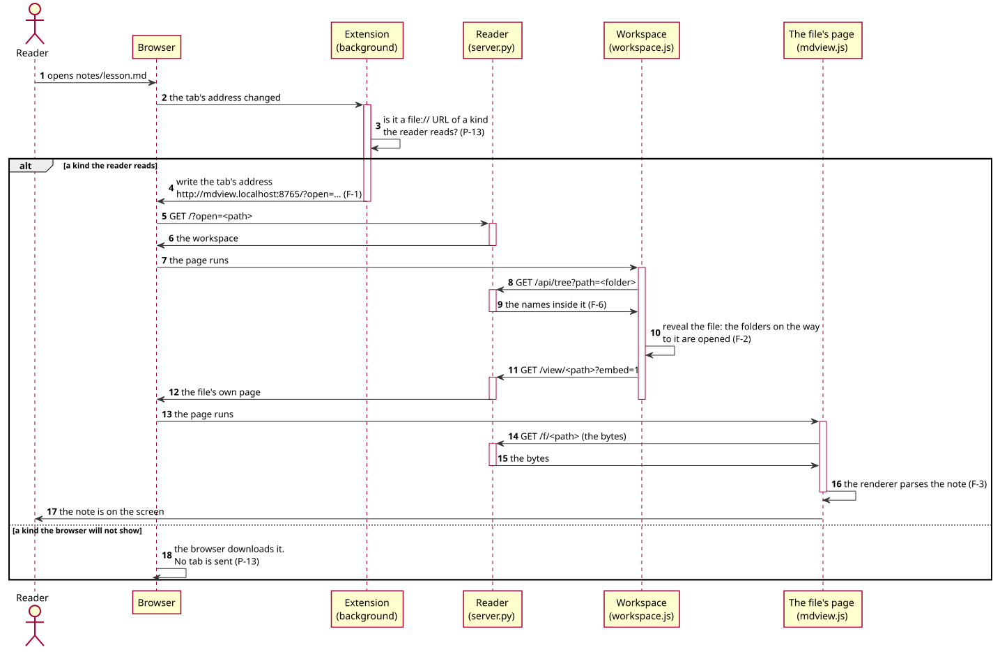
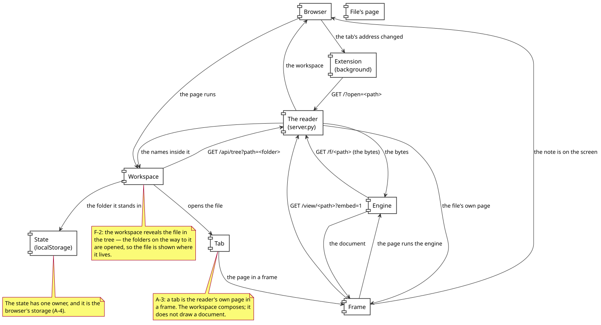

---

### US-02 — The window: folders on the left, tabs along the top

**As a** reader **I want** the folders on the left and the open files along the
top **so that** the window tells me where I am and what I have open.

* **Epic**: EP-01 · **Use case**: UC-03 · **Requirements**: RF-05, RNF-01, RNF-02, RNF-07, RNF-08
* **Size**: L
* **Acceptance criteria**
  1. The window shows the folders on the left, the open files along the top and the document in the middle (F-5).
  2. With nothing open, the middle says *Open file / Select a file to open* (F-5).
  3. The folder the tree is standing in is named above the tree, with its path (F-5).
  4. The window answers a folder of 100 entries in under 50 ms (RNF-01).
  5. The reader's memory stays under 64 MiB while the window is open (RNF-02).

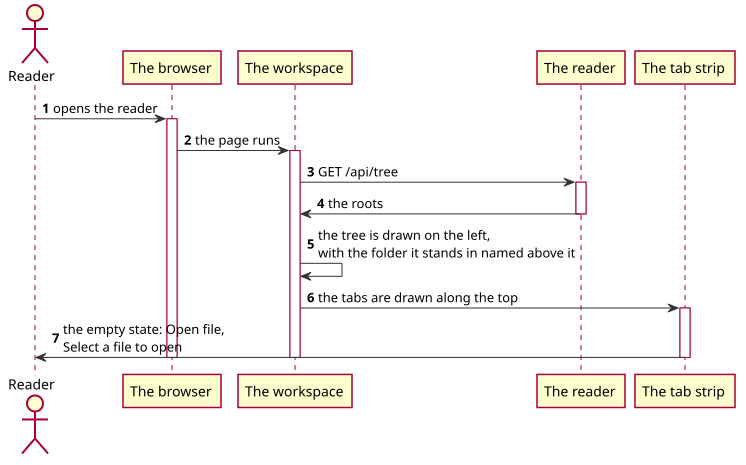

---

### US-03 — A note is rendered and read

**As a** reader **I want** my notes to be rendered **so that** I can read them
the way they were written.

* **Epic**: EP-03 · **Use case**: UC-02 · **Requirements**: RF-02, RF-23, RNF-03
* **Size**: L
* **Acceptance criteria**
  1. The renderer agrees with the official CommonMark 0.31.2 corpus on at least 90 % of its 652 examples (RNF-03).
  2. The GFM extensions the reader declares — tables, task items, strikethrough, autolinks, frontmatter chips — are rendered as the extension says.
  3. The script of a note never runs; only the presentational part of its raw HTML survives (S-4).
  4. A note with a diagram draws it in the reader's own colours.
  5. A note with maths draws it.

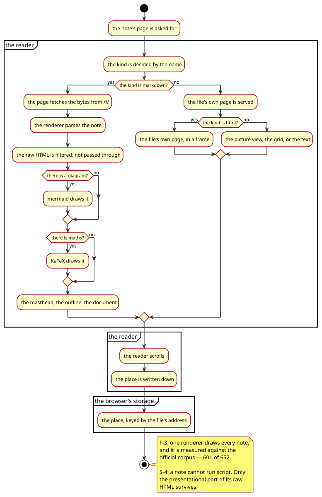
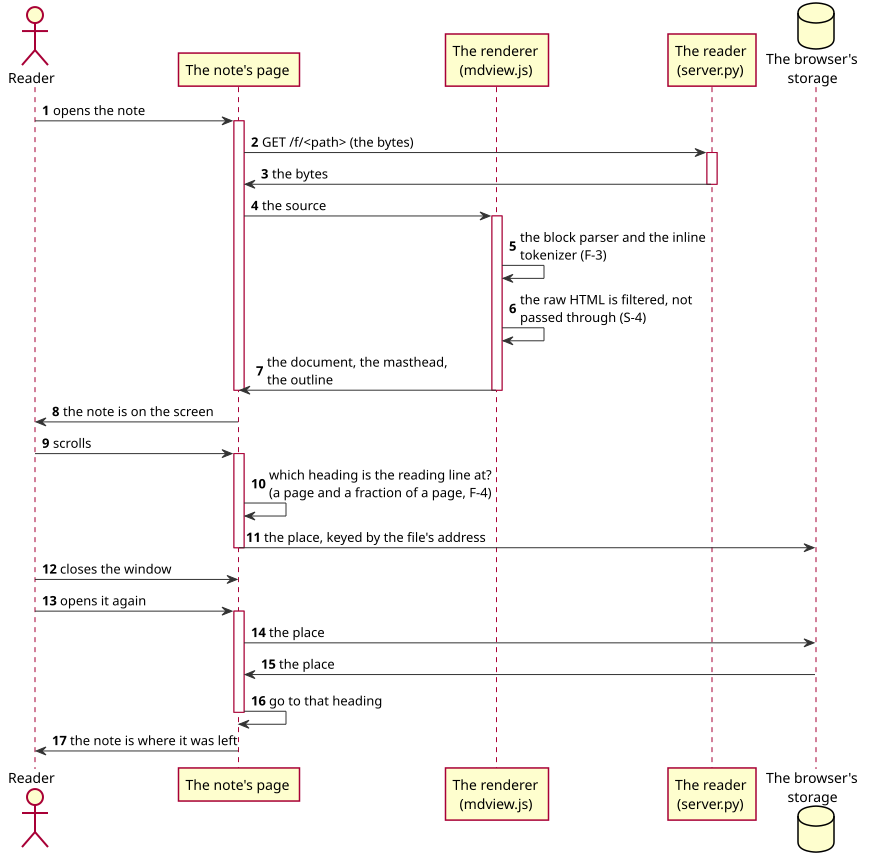

---

### US-04 — A file opens in a tab

**As a** reader **I want** a file to open in a tab **so that** I can have several
open at once and come back to them.

* **Epic**: EP-02 · **Use case**: UC-04 · **Requirements**: RF-06
* **Size**: M
* **Acceptance criteria**
  1. Clicking a file in the tree opens it in a tab, with the mark of its kind and its name.
  2. A second file opens in a second tab; the first keeps its place and its scroll.
  3. A file that is already open is shown in its tab rather than opened twice.
  4. Closing a tab closes it and shows the one beside it.
  5. Every tab is one of the reader's own pages (F-9).

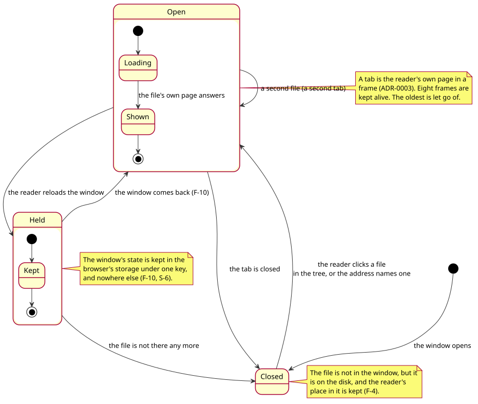

---

### US-05 — The window comes back as it was left

**As a** reader **I want** the window to be where I left it **so that** a reload
does not lose my place.

* **Epic**: EP-01 · **Use case**: UC-04 · **Requirements**: RF-07, RF-27
* **Size**: S
* **Acceptance criteria**
  1. After a reload, the same files are open, and the one that was being read is the one shown.
  2. The folder the tree was standing in is the folder it stands in.
  3. The filters are the filters that were set.
  4. The state is kept in the browser and nowhere else (F-10, F-27).

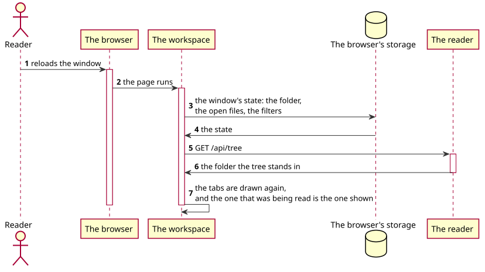

---

### US-06 — The tree is browsed a folder at a time

**As a** reader **I want** the tree to show a folder at a time **so that** a
folder with a thousand files does not take the window down.

* **Epic**: EP-01 · **Use case**: UC-03 · **Requirements**: RF-08
* **Size**: M
* **Acceptance criteria**
  1. The tree shows the contents of the folder it is standing in, and nothing else.
  2. Clicking a folder shows what is inside it, one folder at a time (F-6).
  3. The reader can walk up out of its own folders, one level at a time, and the folders above are shown as they are.
  4. A folder that cannot be shown is refused in words, naming the folder (F-8).
  5. The listing of a folder says what each file is *by its name*; the bytes of a file are not read to find out (F-6).

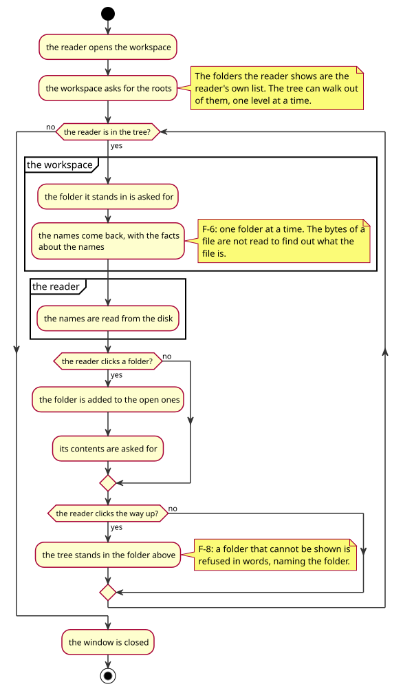

---

### US-07 — The tree is filtered

**As a** reader **I want** to see only the kinds of file I am looking for
**so that** a folder of two thousand files is usable.

* **Epic**: EP-01 · **Use case**: UC-03 · **Requirements**: RF-09
* **Size**: M
* **Acceptance criteria**
  1. The tree can be filtered by name, by kind, by extension, by size and by when the file was last touched.
  2. The filters are controls — a choice from a list — and not a language to be remembered (F-7).
  3. The folders are never filtered out: they are the way to the files (F-7).
  4. The extension list holds only the extensions the tree really has.
  5. Nothing that matches is hidden: a file is kept when it matches every filter that is set.

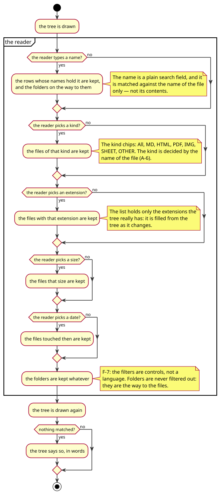

---

### US-08 — The tree is pointed at a folder

**As a** reader **I want** to point the tree at any folder **so that** the
window shows me the part of the disk I am working in.

* **Epic**: EP-01 · **Use case**: UC-11 · **Requirements**: RF-10
* **Size**: M
* **Acceptance criteria**
  1. The three dots on a folder offer to go to that folder, to add it to the reader's own, to open it in the library, and to copy its path.
  2. "Go to this folder" moves the tree there and keeps it there (F-25).
  3. A folder that is not there yet can be made and added in the same breath.
  4. A folder the reader already shows by that name is refused, in words.
  5. A folder inside another one the reader shows is added anyway: it was asked for by name (F-25).

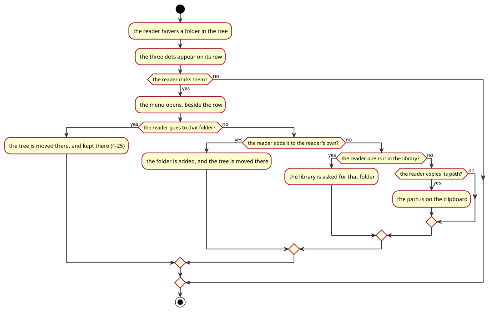

---

### US-09 — A file with no engine opens as its text

**As a** reader **I want** to open any file **so that** the reader is not a
reader of markdown only.

* **Epic**: EP-03 · **Use case**: UC-02 · **Requirements**: RF-03
* **Size**: M
* **Acceptance criteria**
  1. A file with no engine of its own is shown as its own text, with its name, its size, its line count and its folder.
  2. A file that is not text is not shown as broken text: the reader says it is not text and offers the file.
  3. A file bigger than 4 MB is not read into the page.

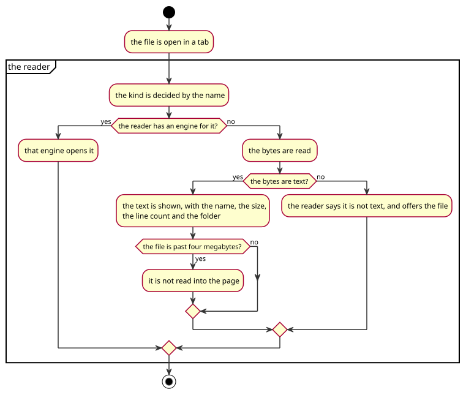

---

### US-10 — A file opened once is kept for two hours

**As a** reader **I want** to open a file without adding it to my folders
**so that** I can look at something and leave no trace of it.

* **Epic**: EP-02 · **Use case**: UC-04 · **Requirements**: RF-03
* **Size**: S
* **Acceptance criteria**
  1. A file picked with the *+* button, or dropped on the window, opens in a tab.
  2. The copy is kept for two hours and then removed, and it never appears in the library (F-9).
  3. The copy is outside the reader's folders, so the tree never shows it.

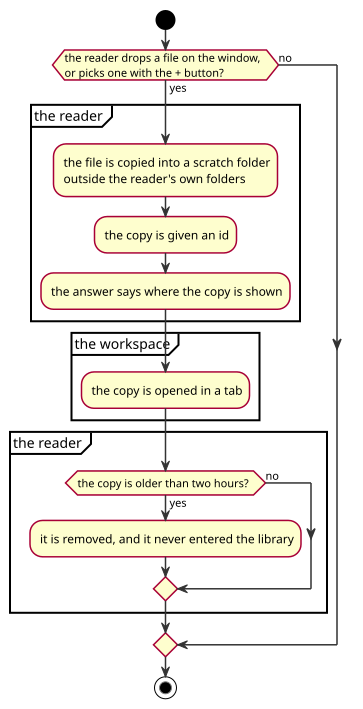

---

### US-11 — The place the reader reached is kept

**As a** reader **I want** to come back to the words I was reading **so that** a
long document is not read twice.

* **Epic**: EP-03 · **Use case**: UC-02 · **Requirements**: RF-11, RF-26
* **Size**: M
* **Acceptance criteria**
  1. The place in a note is a page and a fraction of a page, not a pixel offset (F-4).
  2. A note opened again opens at that place.
  3. The place is kept per file, in the browser, and nowhere else (S-6).
  4. The recently opened files are listed with the place each was reached (F-4).

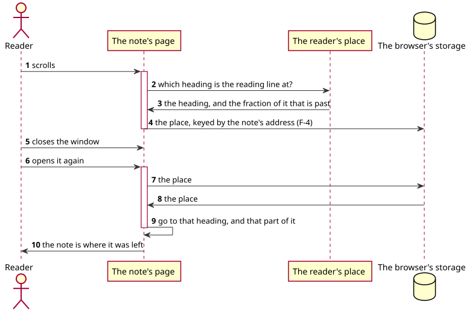

---

### US-12 — A word is looked up

**As a** reader **I want** to double-click a word and see what it means **so
that** I can read without leaving the page.

* **Epic**: EP-04 · **Use case**: UC-05 · **Requirements**: RF-12, RF-13, RF-21, RF-24, RF-25
* **Size**: L
* **Acceptance criteria**
  1. Double-clicking a word in a note, in a PDF or in a page of the reader's own opens a card with the word's senses.
  2. The card asks the background script, never the dictionary itself (F-11, S-3).
  3. Only the three hosts the extension declares are ever asked (S-2).
  4. Where a page cannot hold the card, the definition opens in a tab of the reader's own (F-14).
  5. The card can speak the word aloud, in the voice and at the pace the reader chose (F-13).
  6. On a page the reader does not own, the card is opened by the extension's own menu item, and the page is not changed where the page forbids it (F-14).

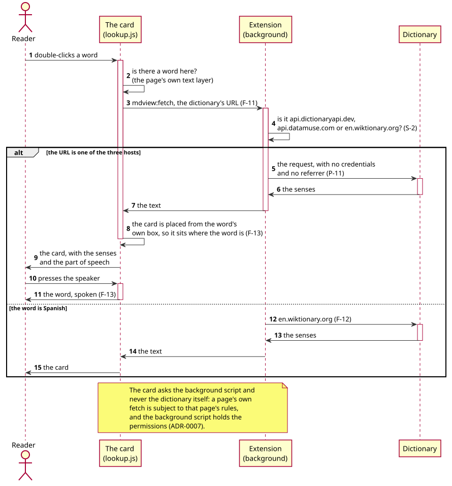

---

### US-13 — A PDF is read

**As a** reader **I want** to read a PDF in the window **so that** a slide or a
manual is a document like any other.

* **Epic**: EP-03 · **Use case**: UC-06 · **Requirements**: RF-11, RF-17, RNF-05
* **Size**: L
* **Acceptance criteria**
  1. Every page gets its box at once, and the pages near the reader are painted as the reader reaches them (F-15).
  2. The window's own bar carries the page number, the page count, the page buttons and the zoom, and it is there whether the file is read on its own or in a frame (F-17).
  3. The page number is a field: a page can be typed and jumped to.
  4. A page's own words can be chosen and looked up, because the file's text is laid over the paint (F-16).
  5. A page bigger than the window is moved with the hand, and a drag that starts on a word is a selection instead (F-18).
  6. The canvas held at once stays under 48 MiB (RNF-05).

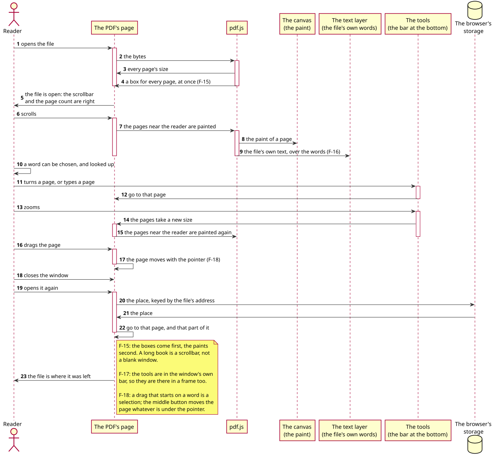

---

### US-14 — A picture is looked at closely

**As a** reader **I want** a picture at its own pixels **so that** a diagram is
sharp when I look at it.

* **Epic**: EP-03 · **Use case**: UC-07 · **Requirements**: RF-18
* **Size**: M
* **Acceptance criteria**
  1. The picture is shown at its own pixels, and is not shrunk to fit the window (F-19).
  2. The zoom is about the pointer, and the steps are sizes a reader would ask for (F-20).
  3. The picture is moved with the hand, and the cursor is a hand over it (F-21).
  4. At a whole number of times the size the pixels stay squares (F-19).
  5. A picture in a note opens in this view when it is clicked, in a tab of the window above (F-28).

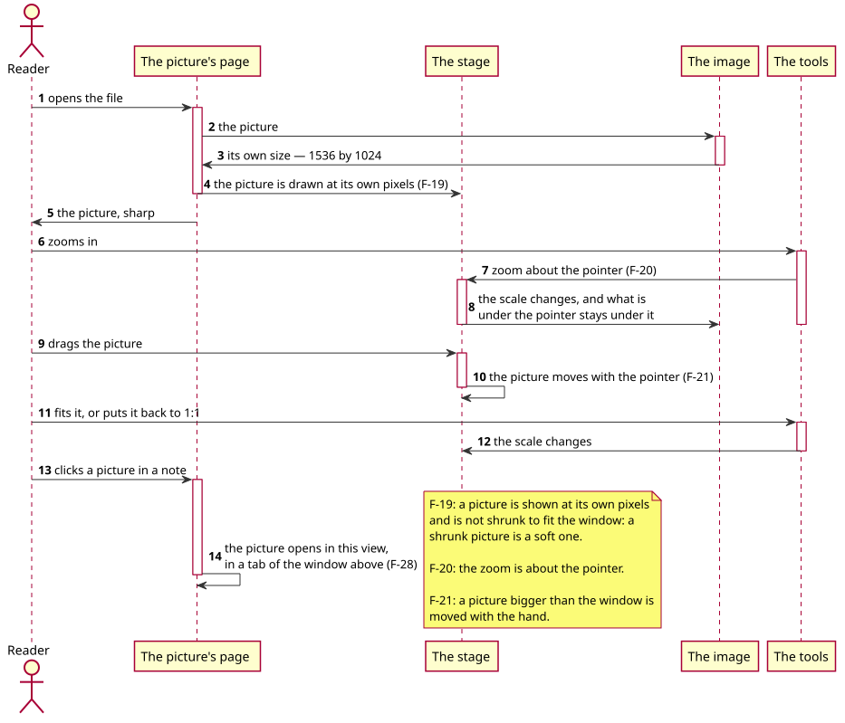

---

### US-15 — A spreadsheet is read

**As a** reader **I want** to read a workbook or a CSV **so that** a table is a
document like any other.

* **Epic**: EP-03 · **Use case**: UC-08 · **Requirements**: RF-03, RF-19
* **Size**: L
* **Acceptance criteria**
  1. A workbook's sheets are drawn as a grid, and a CSV is drawn the same way (F-22).
  2. The grid scrolls, and the reader can sort it.

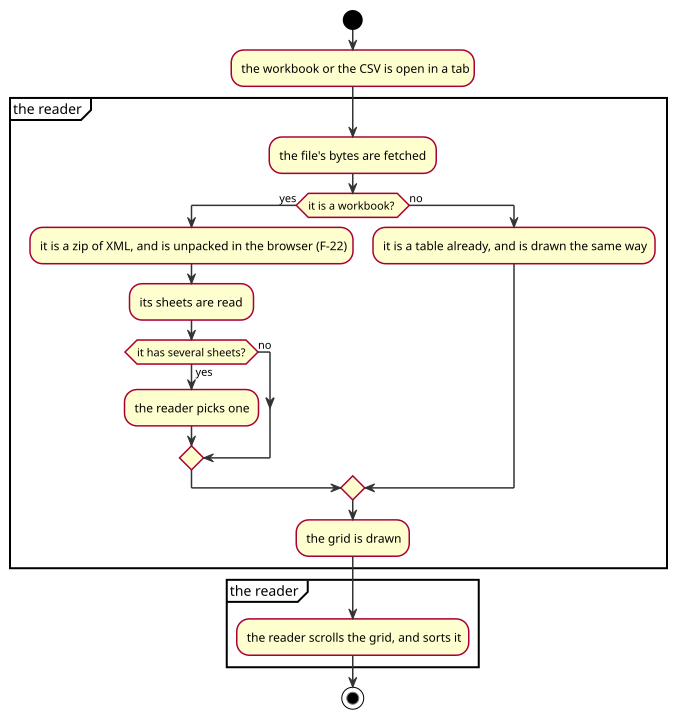

---

### US-16 — The library, and the reader's choices

**As a** reader **I want** to organise my notes and to have the reader look the
way I want it **so that** the window is mine.

* **Epic**: EP-05 · **Use case**: UC-09, UC-13 · **Requirements**: RF-15, RF-20, RF-27
* **Size**: M
* **Acceptance criteria**
  1. The library adds, renames and deletes notes and pictures, and makes folders, inside the reader's folders.
  2. A write that did not come from the reader's own pages is refused, with the reason (S-1).
  3. The light, dark and warm desks, the reading width, the face, the dictionary language and the voice are choices the reader makes, and they apply to every page of the reader's own (F-27).
  4. The choices are kept in the browser and nowhere else: the reader keeps nothing about the person who reads (S-6).

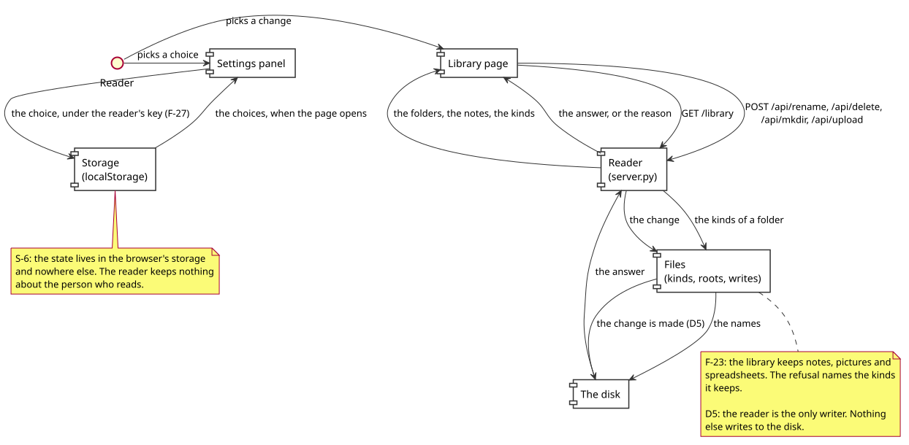

---

### US-17 — A note is found by name

**As a** reader **I want** to find a note I cannot remember the folder of **so
that** the folders do not have to be remembered.

* **Epic**: EP-05 · **Use case**: UC-10 · **Requirements**: RF-16
* **Size**: S
* **Acceptance criteria**
  1. The search finds the notes whose name holds the text, in any folder under the reader's roots.
  2. The answer says which it gave: the folders walked just now, or the index built in the background (F-24).
  3. Each result says which folder it is in.

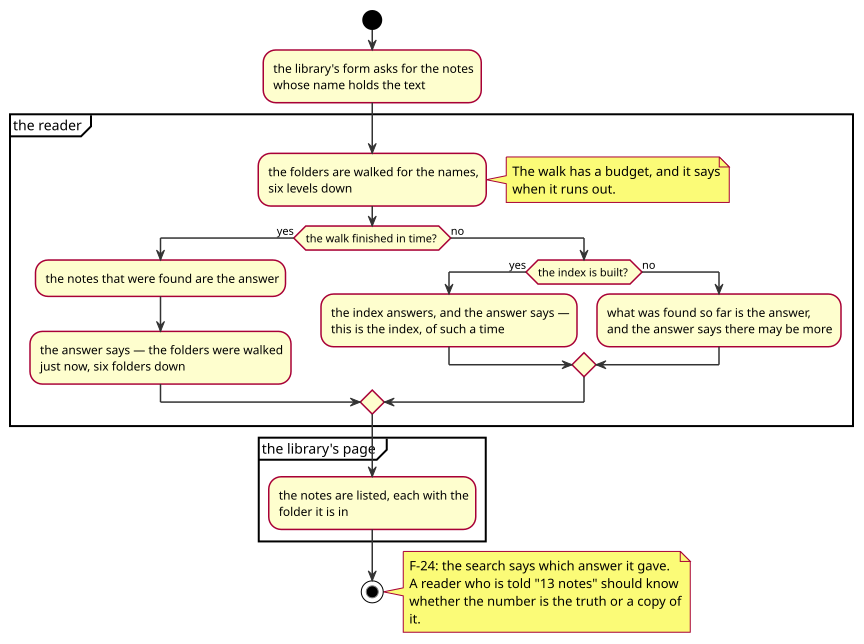

---

### US-18 — A file from outside the reader's folders

**As a** reader **I want** the reader to offer to show me a file it does not
have **so that** nothing is refused without a way forward.

* **Epic**: EP-02 · **Use case**: UC-12 · **Requirements**: RF-04, RF-14, RF-22
* **Size**: M
* **Acceptance criteria**
  1. A file outside the reader's folders is answered with a page that says where the file is, and offers to add the folder that holds it (F-26).
  2. The folder can be added, and the file then opens in a tab.
  3. The file can also be read once, without the folder being added.
  4. A refusal names the folder and the reason (F-8).

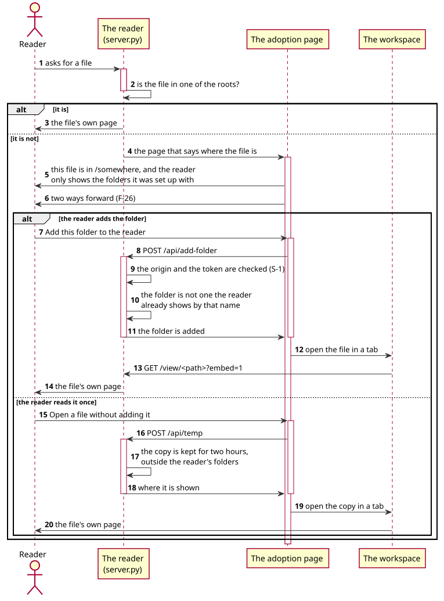
