# The use cases

Every use case in the [catalogue](requirements.md#4-use-cases) is described here,
in Jacobson's template: the actor, the trigger, the main flow, the
alternatives, the exceptions and the business rules the flow obeys. A catalogue
entry with a title and no flow is a placeholder, and a requirement traced to it
is traced to nothing.

The rules the flows obey are numbered in the
[specification](../specification/) and are cited by number here, so that the
flow and the specification cannot drift apart.

---

## UC-01 — Open a local file in the workspace

| | |
|---|---|
| **Actor** | Reader, through the Browser |
| **Requirements** | RF-01, RNF-04 |
| **Stories** | US-01 |
| **Preconditions** | The reader service is running; the extension is installed and enabled |
| **Postconditions** | The file is open in a tab of the workspace, and the tree shows where it lives |
| **Trigger** | The reader opens a local file the browser can show — a `.md`, a `.pdf`, a `.txt` |

**Main flow**

1. The browser opens the file at its `file://` address.
2. The extension sees the address, decides the kind is one the reader reads, and writes the reader's address into the tab: the workspace, with the file's path named in it (F-1).
3. The workspace reads the path from its address, moves its tree to the folder that holds the file, and opens the file in a tab (F-2).
4. The workspace asks the reader for the file's page and shows it in the tab's frame.

**Alternatives**

* 2a. The kind is one the browser will not show (a `.xlsx`, say) → the browser downloads it instead, and nothing happens. The reader's library and its *Open a file* button are how such a file arrives (F-9).
* 3a. The file is not in one of the reader's folders → the tab shows the page that offers to add the folder that holds it (UC-12).

**Exceptions**

* The reader is not running → the tab shows the browser's own error. The extension does not retry; the reader service restarts itself.

**Business rules**

* F-1 — the extension sends the file to the reader and does not render it itself.
* F-2 — the workspace reveals the file in the tree: the folders on the way to it are opened, and the file is shown where it lives.

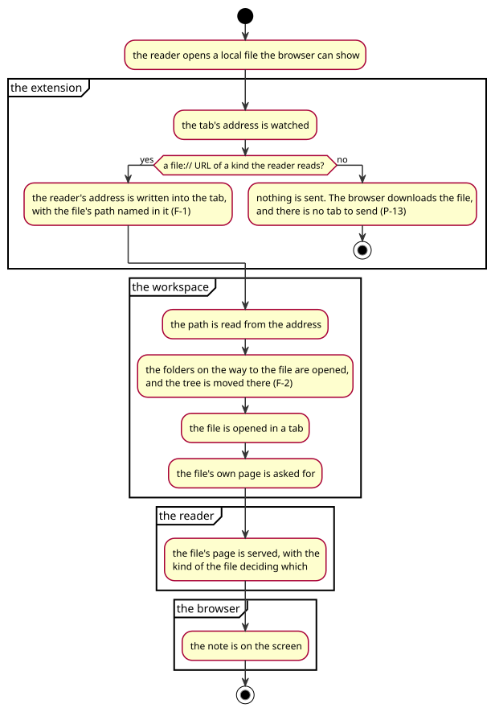

---

## UC-02 — Read a note

| | |
|---|---|
| **Actor** | Reader |
| **Requirements** | RF-02, RF-03, RF-11, RF-23, RF-26, RNF-03 |
| **Stories** | US-03, US-11 |
| **Preconditions** | A note is open in a tab |
| **Postconditions** | The note is on the screen, and the place the reader reached is kept |
| **Trigger** | The reader clicks the note in the tree, or the file arrives by UC-01 |

**Main flow**

1. The workspace asks the reader for the note's page.
2. The reader's page fetches the note's bytes and hands them to the renderer.
3. The renderer parses the note (CommonMark 0.31 with the GFM extensions) and builds the document: the masthead with the note's title, its statistics and the reader's choices; the outline of its headings; the document itself (F-3).
4. The reader scrolls, and the place reached is written down as a page and a fraction of a page (F-4).
5. The reader comes back later → the note opens where it was left (F-4).

**Alternatives**

* 3a. The note carries raw HTML → only the presentational parts of it survive; the rest is escaped (S-4).
* 3b. The note carries a diagram → it is drawn by mermaid, in the reader's own colours (F-3).
* 3c. The note carries maths → it is drawn by KaTeX (F-3).
* 5a. The note is not there any more → the reader is told the file cannot be read, and the tab stays.

**Exceptions**

* The bytes cannot be fetched → the page says so, in the place the note would have been.
* The renderer finds no source to render → the page warns, in the console, rather than showing nothing (F-3).

**Business rules**

* F-3 — one renderer for every note, measured against the official corpus.
* F-4 — the place is a page and a fraction of a page, kept in the browser and nowhere else (S-6).
* S-4 — a note cannot run script.

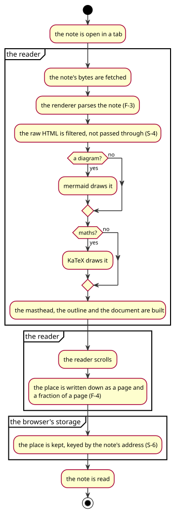

---

## UC-03 — Browse the folders

| | |
|---|---|
| **Actor** | Reader |
| **Requirements** | RF-05, RF-08, RF-09, RNF-01, RNF-02, RNF-07, RNF-08 |
| **Stories** | US-02, US-06, US-07 |
| **Preconditions** | The workspace is open |
| **Postconditions** | The tree shows the folder the reader is standing in |
| **Trigger** | The reader opens the workspace, clicks a folder, or types in the filter |

**Main flow**

1. The workspace asks the reader for the names inside the current folder.
2. The reader answers with each name, whether it is a folder or a file, its kind, its size and when it was last touched (F-6).
3. The workspace draws them: folders with a chevron, files with the mark of their kind; the folder the reader is standing in is named above them.
4. The reader clicks a folder → the workspace asks for what is inside it and draws it underneath (F-6).
5. The reader types in the filter → the tree keeps the rows whose names hold the text, and the folders on the way to them (F-7).
6. The reader picks a kind, an extension, a size or a date → the tree keeps the files that are like that, and the folders (F-7).

**Alternatives**

* 2a. The folder holds a thousand files → the answer is the names and nothing else; the reader does not read the files to find out what they are (F-6).
* 4a. The folder is outside the reader's folders → the reader says it cannot be shown (F-8).
* 6a. The filter matches nothing → the tree says so, in words.

**Exceptions**

* The folder cannot be read (a broken link, a permission) → the entry is passed over rather than ending the listing.

**Business rules**

* F-6 — the tree is browsed a folder at a time; nothing walks the disk on the reader's behalf without being asked.
* F-7 — the filters are controls, not a language; the folders are never filtered out, because they are the way to the files.
* F-8 — a refusal is readable and names the folder.

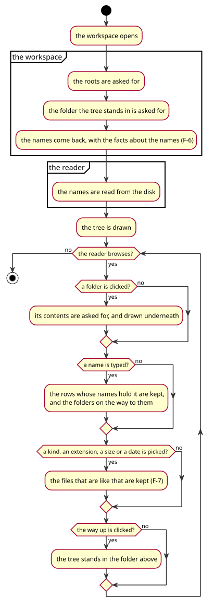

---

## UC-04 — Open a file in a tab

| | |
|---|---|
| **Actor** | Reader |
| **Requirements** | RF-06, RF-07 |
| **Stories** | US-04, US-05 |
| **Preconditions** | The workspace is open |
| **Postconditions** | The file is open in a tab, and the set of tabs is remembered |
| **Trigger** | The reader clicks a file in the tree, the *+* button, or a link in a note |

**Main flow**

1. The reader clicks a file in the tree → the workspace opens a tab for it, with the mark of its kind and its name.
2. The workspace asks the reader for the file's page and shows it in the tab's frame.
3. The reader opens a second file → a second tab; the first stays where it was (F-9).
4. The reader closes a tab → the tab goes, and the one beside it is shown.
5. The reader reloads the window → the tabs are there again, and the one that was being read is the one shown (F-10).

**Alternatives**

* 1a. The file is already open → its tab is shown instead of a second one.
* 1b. The reader drops a file on the window, or picks one with the *+* button → the file is kept for two hours and opened in a tab, without being added to the reader's folders (F-9).
* 1c. The reader presses *Open a file* on a page of the reader's own → the same thing.

**Exceptions**

* The file cannot be read → the tab shows the reader's refusal, in the frame, and the tab stays.

**Business rules**

* F-9 — every tab is one of the reader's own pages; the workspace does not draw a document itself.
* F-10 — the window's state is kept in the browser, and nowhere else.

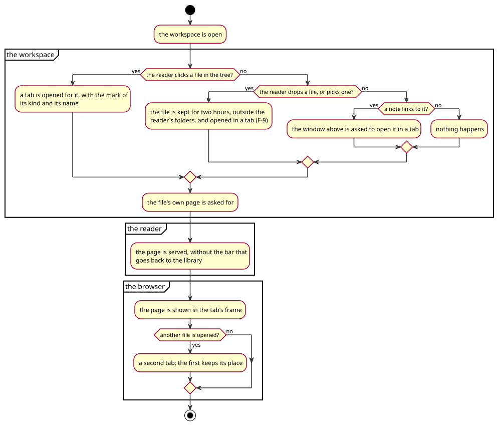

---

## UC-05 — Look a word up

| | |
|---|---|
| **Actor** | Reader |
| **Requirements** | RF-12, RF-13, RF-21, RF-24, RF-25 |
| **Stories** | US-12 |
| **Preconditions** | A page with words is open |
| **Postconditions** | The card shows the word's senses, or says that there are none |
| **Trigger** | The reader double-clicks a word, in the reader's own pages or on any page of the browser |

**Main flow**

1. The reader double-clicks a word.
2. The card asks the background script for the word (F-11).
3. The background script asks the free dictionary, and the thin one when the rich one has no entry, and Spanish Wiktionary for a Spanish word (F-12).
4. The card shows the senses, the part of speech, and the example, and can speak the word (F-13).

**Alternatives**

* 2a. The page cannot hold the card — a page of the browser's own, a PDF viewer, the add-ons site → the definition opens in a tab of the reader's own instead (F-14).
* 3a. The first dictionary has nothing and the second has nothing → the card says the word is not in either dictionary.
* 3b. The word is Spanish → the Spanish source is asked instead (F-12).

**Exceptions**

* The dictionary hosts cannot be reached → the card says the lookup failed, in words.

**Business rules**

* F-11 — the card asks the background script, never the dictionary itself: a page's own fetch is subject to that page's rules, and the background script holds the permissions (S-3).
* F-12 — only the three hosts the extension declares are ever asked (S-2).
* F-13 — the card is a card on the page, not a window of its own, wherever the page allows it.
* F-14 — where a card cannot live, a tab takes its place.

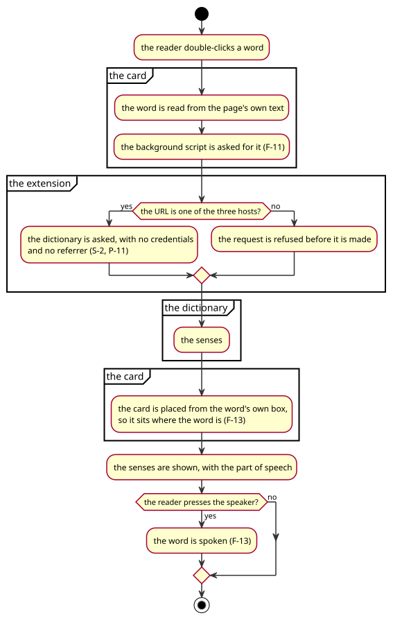

---

## UC-06 — Read a PDF

| | |
|---|---|
| **Actor** | Reader |
| **Requirements** | RF-11, RF-17, RNF-05 |
| **Stories** | US-13 |
| **Preconditions** | A PDF is open in a tab |
| **Postconditions** | The pages are on the screen, and the reader's place in the file is kept |
| **Trigger** | The reader opens the file, or comes back to it |

**Main flow**

1. The reader's page asks for the file's bytes and hands them to pdf.js.
2. Every page gets its box at the size the file says, so that the scrollbar and the page count are right at once (F-15).
3. The pages near the reader are painted: a canvas for the paint, the file's own text laid invisibly over it so a word can be chosen and looked up (F-16).
4. The reader turns a page, jumps to a page, or zooms — the bar at the bottom of the window does all three (F-17).
5. The reader drags the page with the hand when it is bigger than the window (F-18).
6. The reader comes back later → the file opens at the page and the fraction of it that was reached (F-4).

**Alternatives**

* 2a. The file has twelve hundred pages → the boxes are made at once and the paints are made as the reader reaches them, under a budget of 48 MiB of canvas (F-15).
* 3a. A page cannot be painted → the page says so and keeps its size, so the pages after it stay where the file put them.

**Exceptions**

* The file cannot be opened → the page says why.
* A page's paint fails → that page says it; the rest of the file is unaffected.

**Business rules**

* F-15 — the boxes come first, the paints second: a long book is a scrollbar, not a blank window.
* F-16 — a page is a paint and the file's own text over it.
* F-17 — the tools are in the window's own bar, not in the reader's bar, so that they are there in a frame too.
* F-18 — a drag that starts on a word is a selection, not a move.

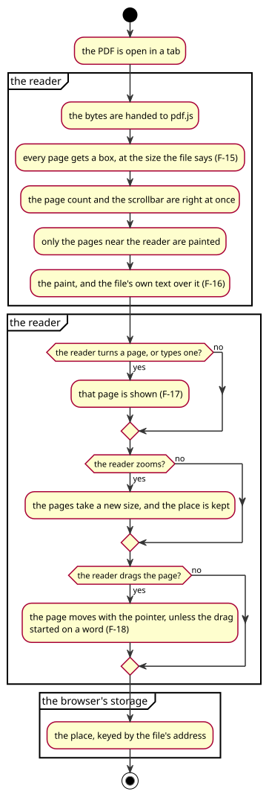

---

## UC-07 — Look at a picture

| | |
|---|---|
| **Actor** | Reader |
| **Requirements** | RF-03, RF-18 |
| **Stories** | US-14 |
| **Preconditions** | A picture is open in a tab |
| **Postconditions** | The picture is on the screen at its own pixels |
| **Trigger** | The reader opens the file |

**Main flow**

1. The reader's page shows the picture on a desk, at its own pixels — a picture bigger than the window is not shrunk to fit, because a shrunk picture is a soft one (F-19).
2. The reader zooms with the bar or with the wheel, and the zoom keeps the place under the pointer (F-20).
3. The reader drags the picture with the hand, and the cursor is a hand over it (F-21).
4. The reader fits the picture in the window, or puts it back to its own size (F-20).

**Alternatives**

* 1a. The picture is an SVG → it is drawn as a vector, and stays sharp at every zoom.

**Exceptions**

* The file is not a picture the browser can draw → the reader says so.

**Business rules**

* F-19 — a picture is shown at its own pixels.
* F-20 — the zoom is about the pointer, and the steps are sizes a reader would ask for.
* F-21 — a picture bigger than the window is moved with the hand.

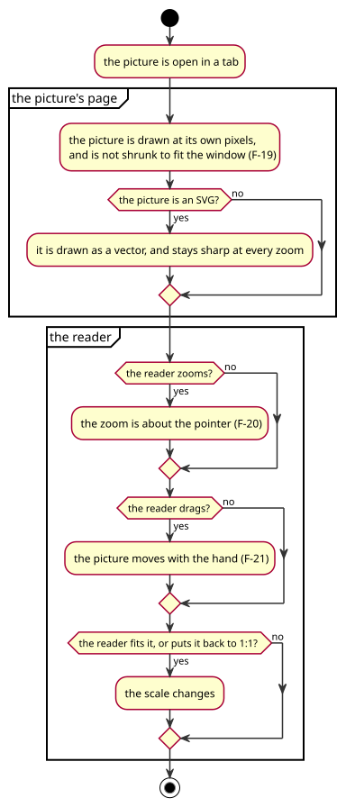

---

## UC-08 — Read a spreadsheet

| | |
|---|---|
| **Actor** | Reader |
| **Requirements** | RF-03, RF-19 |
| **Stories** | US-15 |
| **Preconditions** | A workbook or a CSV is open in a tab |
| **Postconditions** | The grid is on the screen |
| **Trigger** | The reader opens the file |

**Main flow**

1. The reader's page asks for the file's bytes from the reader's own `/f/` route.
2. A workbook is a zip of XML: it is unpacked in the browser and its sheets are drawn; a CSV is a table already and is drawn the same way (F-22).
3. The reader reads the grid: scrolls it, and sorts it.

**Alternatives**

* 2a. The workbook has several sheets → the reader picks one.

**Exceptions**

* The file is not a workbook → the page says so.

**Business rules**

* F-22 — a workbook and a CSV are the same engine; the only difference is the zip.

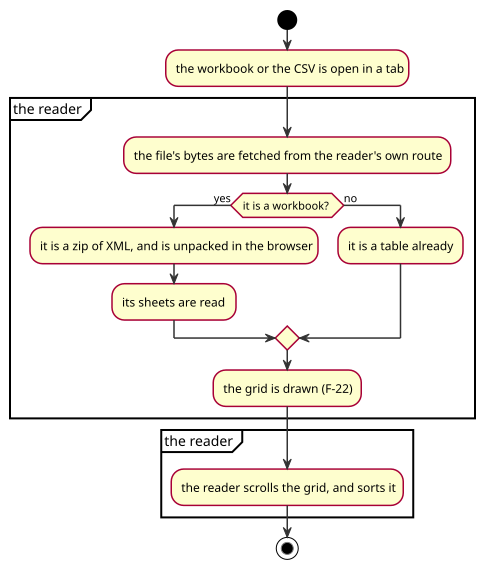

---

## UC-09 — Organise the library

| | |
|---|---|
| **Actor** | Reader |
| **Requirements** | RF-15, RF-22 |
| **Stories** | US-16 |
| **Preconditions** | The library is open |
| **Postconditions** | The change is on the disk, and the listing shows it |
| **Trigger** | The reader adds, renames, deletes or makes a folder |

**Main flow**

1. The reader picks a change in the library.
2. The page asks the reader to do it, with the origin and the token (S-1).
3. The reader checks that the change is inside one of its folders, makes it, and answers.
4. The page reloads, and the listing is what is on the disk.

**Alternatives**

* 3a. The file is not one the library keeps → the reader refuses, and says which kinds it keeps (F-23).

**Exceptions**

* The change cannot be made → the page says why the change could not be made.

**Business rules**

* F-23 — the library keeps notes, pictures and spreadsheets; the other kinds are not in it, and the refusal names them.
* S-1 — a write needs the reader's own origin and the reader's own token.

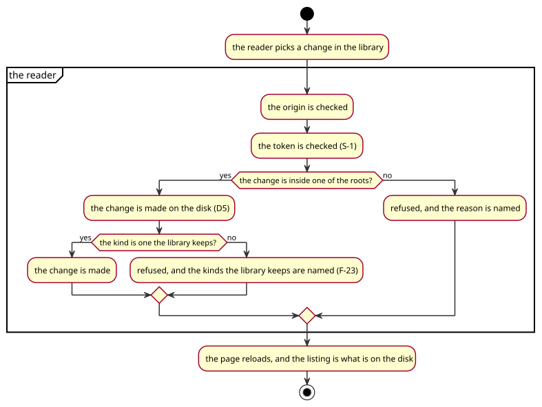

---

## UC-10 — Find a note

| | |
|---|---|
| **Actor** | Reader |
| **Requirements** | RF-16 |
| **Stories** | US-17 |
| **Preconditions** | The library is open |
| **Postconditions** | The notes with that name are listed, with the folder each is in |
| **Trigger** | The reader types a name in the library's search box |

**Main flow**

1. The library's form asks the reader for the notes whose name holds the text.
2. The reader walks its folders for the names, six levels down, and answers with what it found (F-24).
3. The page lists them, each with the folder it is in.

**Alternatives**

* 2a. The walk takes longer than its budget → the index built in the background answers instead, and the page says which answered (F-24).

**Exceptions**

* Nothing matches → the page says so.

**Business rules**

* F-24 — the search says which answer it gave: the folders walked just now, or the index.

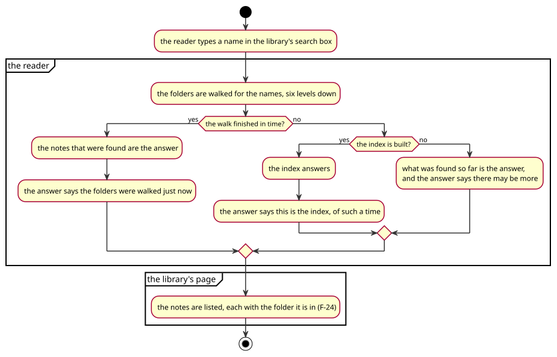

---

## UC-11 — Add a folder to the reader

| | |
|---|---|
| **Actor** | Reader |
| **Requirements** | RF-10, RF-22 |
| **Stories** | US-08 |
| **Preconditions** | The workspace is open |
| **Postconditions** | The folder is one of the reader's own, and the tree is standing in it |
| **Trigger** | The reader asks for a folder by name, or picks one of the three dots on a folder in the tree |

**Main flow**

1. The reader types a path, or picks a folder in the tree and asks for it to be added.
2. The reader checks the folder: it must be a folder, and it must not be one it already shows, nor hold one that it does (F-25).
3. The reader adds it to its own list and saves the list.
4. The tree is moved there.

**Alternatives**

* 2a. The folder is not there yet → the reader makes it, and adds it (F-25).
* 2b. The folder is inside a folder the reader already shows → it is added anyway: the reader asked for it by name, and showing it twice is better than refusing what was asked for (F-25).

**Exceptions**

* The folder is a file → the reader says so.
* The whole disk → the reader refuses.

**Business rules**

* F-25 — a folder the reader already shows by that name is refused; a folder inside another one is not.

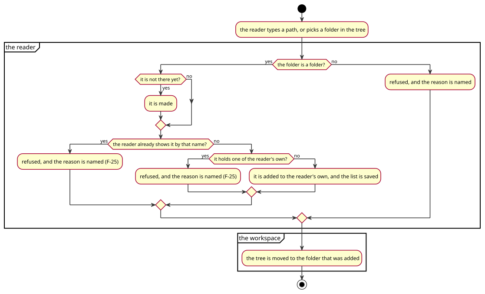

---

## UC-12 — Open a file from outside the reader's folders

| | |
|---|---|
| **Actor** | Reader |
| **Requirements** | RF-04, RF-14 |
| **Stories** | US-18 |
| **Preconditions** | The reader is asked for a file it is not allowed to show |
| **Postconditions** | The reader has offered to add the folder that holds it |
| **Trigger** | The browser opens a file outside the reader's folders, or the tree is walked out of them |

**Main flow**

1. The reader is asked for the file and finds it is not in one of its folders.
2. It answers with the page that says where the file is, and offers two ways forward: add the folder that holds it, or read the file once without keeping it (F-26).
3. The reader adds the folder → the file opens in a tab, and the tree is standing in the folder that holds it.

**Alternatives**

* 2a. The reader reads it once → the file is kept for two hours, outside the reader's folders, and never appears in the library.

**Exceptions**

* The folder cannot be added → the page says why.

**Business rules**

* F-26 — a file outside the reader's folders is never silently refused and never silently shown: the page says where it is and offers the choice.

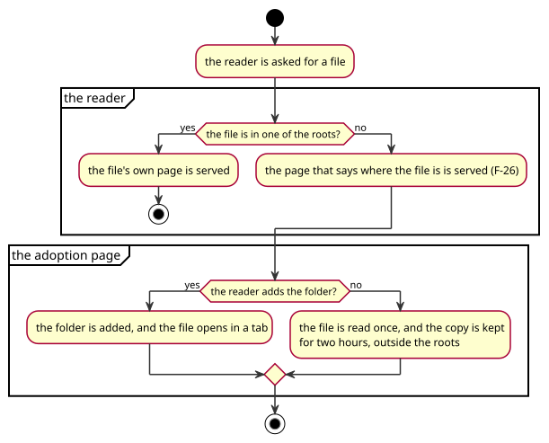

---

## UC-13 — Set the reader's preferences

| | |
|---|---|
| **Actor** | Reader |
| **Requirements** | RF-20, RF-27 |
| **Stories** | US-16 |
| **Preconditions** | Any page of the reader's own is open |
| **Postconditions** | The choice is kept, and every page of the reader's own follows it |
| **Trigger** | The reader changes the desk, the width, the face, the dictionary language or the voice |

**Main flow**

1. The reader picks a choice in the settings panel.
2. The page writes it into the browser's own storage, under its own key (F-27).
3. The page applies it at once, and every other page of the reader's own applies it when it opens.

**Alternatives**

* 3a. The browser refuses to keep the choice (a private window) → the choice applies to the page and is not kept, and the reader is not troubled.

**Exceptions**

* The stored value is not one of the choices → the default is used.

**Business rules**

* F-27 — the choices live in the browser and nowhere else; the reader keeps nothing about the person who reads.

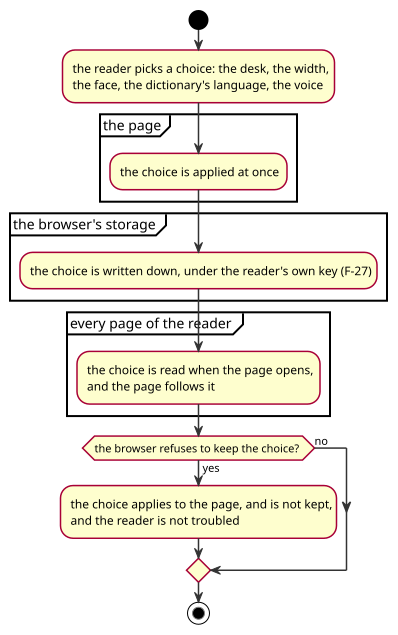
