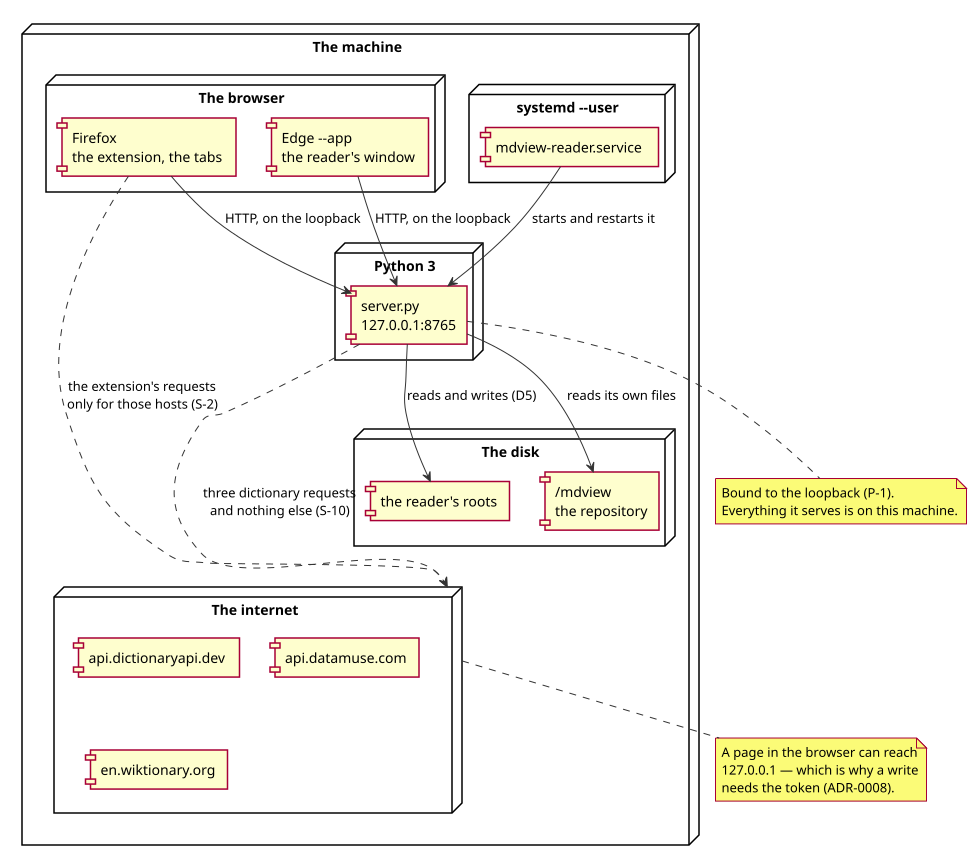

# Deployment

Where the reader runs, what it shows, and what has to be true for it to work.

## The service

The reader is a user service, started by systemd:

```ini
# ~/.config/systemd/user/mdview-reader.service
[Unit]
Description=mdview reader (local notes server on 127.0.0.1:8765)
After=default.target

[Service]
Type=simple
WorkingDirectory=%h/mdview/reader
ExecStart=/usr/bin/python3 %h/mdview/reader/server.py
Environment=MDVIEW_ENGINE=%h/mdview/extension
Restart=always
RestartSec=2
StandardOutput=journal
StandardError=journal

[Install]
WantedBy=default.target
```

The `MDVIEW_ENGINE` line says where the engines are — the renderer, the PDF
view, the sheet view and the word card. Without it the reader looks for them
beside itself, in `../extension`, which is where they are in this repository.

```bash
systemctl --user start mdview-reader.service
systemctl --user status mdview-reader.service
journalctl --user -u mdview-reader.service -f
```

It binds `127.0.0.1:8765` and nothing else (P-1). The three addresses it
answers on are `mdview.localhost:8765`, `127.0.0.1:8765` and
`localhost:8765`; the first is the one the extension uses, because it is a name
rather than an address and it cannot be another machine's loopback.

`Restart=always` means the reader comes back after a crash, and the token it
mints changes with it — a page that was open yesterday cannot write today
(ADR-0008).

## The folders

The reader shows the folders listed in `reader/roots.json`:

```json
[
  "~/notes",
  "~/documents/books",
  "/mnt/data/notes"
]
```

A path may be absolute or begin with `~`. The list is read when the reader
starts, and the reader's *Add a folder* writes to it.

The reader may show **any** folder on the machine in the tree — the tree walks
out of the roots, one level at a time — but it may only *read* the files inside
the roots, and it may only *write* inside them.

## The window

```bash
reader/open.sh
```

It makes sure the service is running and opens the reader in its own window
(`microsoft-edge --app=…`). The app mode gives the window no browser chrome,
which is what a reader wants; the same address opened in a tab works the same.

## The extension

The extension is a Firefox add-on. It is built with
`bash dev/build.sh` and installed with
`bash dev/sideload.sh`, which copies the package into the
profile's `extensions` folder.

It needs three permissions, and the manifest asks for no more:

| Permission | Why |
|---|---|
| `file:///*` | to see that a tab's address is a local file |
| `tabs` | to see the tab's address, and to write the reader's address into it |
| `storage` | to keep the reader's choices and the places |
| the three dictionary hosts | to ask for a word's meanings (S-2) |

The add-on has to be enabled in `about:addons`, and Firefox has to be told to
allow the unsigned package.

## The Chrome variant

`the Chrome variant (not in this repository)` is a separate extension (manifest v3) that renders
markdown in place instead of sending the file to the reader. It shares the
renderer with the Firefox one and has its own PDF view, and it is not covered
by any of the suites — see
[the gaps](../analysis/requirements.md#6-the-gaps).

## What has to be true

* the reader's service is running (`systemctl --user status`);
* `reader/roots.json` holds the folders to show;
* the extension is installed, enabled, and allowed the three dictionary hosts;
* the browser can reach `mdview.localhost:8765` — which it can, because
  `*.localhost` resolves to the loopback.

## Where it runs



*Everything is on one machine. The only arrows that leave it are the three
dictionary requests (S-10) — and a page in the browser can reach the reader,
which is why a write needs the token (ADR-0008).*

## The reader's own files

| Where | What |
|---|---|
| `reader/roots.json` | the folders the reader shows |
| `reader/temp/` | the files opened once, swept after two hours |
| `reader/server.py` | the reader |
| `reader/workspace.*`, `text.css`, `imageview.*` | the window's own files |
| `~/mdview/extension/` | the engines and the extension |
| `~/mdview/dev/` | the tooling, the suites, the checks |
