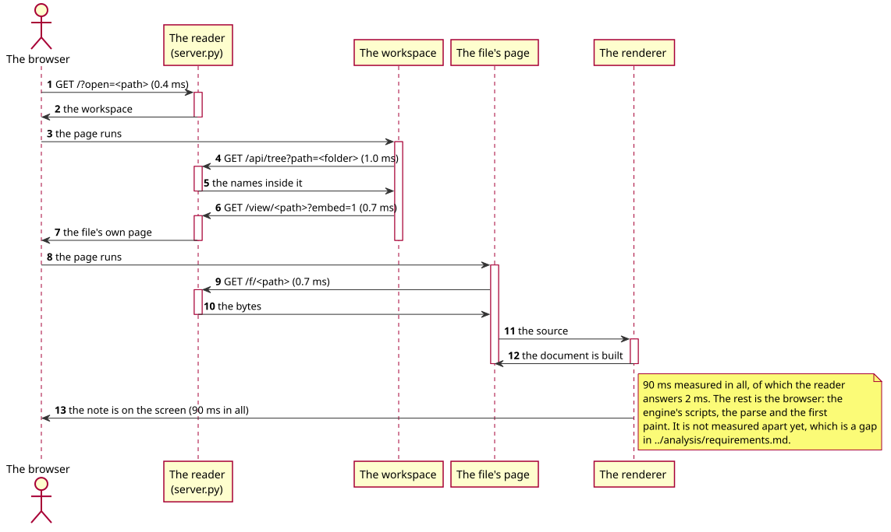

# Performance

The numbers the [specification](../specification/05-quality.md) quotes, and the
method that produced them. A claim that is not measured is a claim; where a
number is a target rather than a measurement, it says so.

## The method

The machine, on 2026-10-21:

| | |
|---|---|
| The reader | `reader/server.py`, Python 3.12, systemd `--user` service |
| The engine | `~/mdview/extension/` |
| The browser | Chromium, headless, through Playwright |
| The disk | the reader's own disk, warm |

The reader's answers are timed over the loopback, from the shell, with the
median of twelve requests (the median, because the first request of a batch
pays for the page cache):

```bash
python3 - <<'PY'
import time, urllib.request, statistics
BASE = "http://127.0.0.1:8765"
for path in ["/", "/api/tree?path=%2Fnotes"]:
    times = []
    for _ in range(12):
        t = time.monotonic()
        urllib.request.urlopen(BASE + path).read()
        times.append((time.monotonic() - t) * 1000)
    print(f"{path:44} {statistics.median(times):7.1f} ms")
PY
```

The reader's memory and CPU come from the kernel, and the idle figure is the
difference of two samples taken thirty seconds apart with nothing asked of it:

```bash
pid=$(systemctl --user show -p MainPID --value mdview-reader.service)
awk '/VmRSS/ {printf "RSS %.1f MiB\n", $2/1024}' /proc/$pid/status
a=$(awk '{print $14+$15}' /proc/$pid/stat); sleep 30
b=$(awk '{print $14+$15}' /proc/$pid/stat)
echo "idle CPU: $(python3 -c "print('%.2f %%' % (($b-$a)/100/30*100))") of a core"
```

The time from the tab's address to the note on the screen is measured in the
browser, because that is the only place the whole path is visible:

```python
t = time.monotonic()
page.goto(url, wait_until="load")
page.frame_locator(".ws-frame").locator("h1").first.wait_for()
print(time.monotonic() - t)
```

## The numbers



*90 ms in all, of which the reader answers 2 ms. The rest is the browser: the
engine's scripts, the parse and the first paint.*

| What | Target | Measured | Method |
|---|---|---|---|
| The workspace page | — | 0.4 ms, 14.7 KB | the median of 12 requests |
| A folder listing (46 entries) | ≤ 50 ms (RNF-01) | 1.0 ms, 8.0 KB | the median of 12 requests |
| A note's page | — | 0.7 ms, 6.7 KB | the median of 12 requests |
| The address to the note on the screen | ≤ 1.5 s (RNF-04) | 0.09 s | five loads, the median |
| The reader's memory, after an afternoon | ≤ 64 MiB (RNF-02) | 33.0 MiB | `/proc/<pid>/status` |
| The reader's CPU with nobody reading | ≤ 1 % of a core (RNF-08) | **3.1 %** — not met | two samples, 30 s apart |
| The renderer's score | ≥ 90 % (RNF-03) | 92.2 % (601/652) | `test/score-backup.js` |
| The interface suite's run | ≤ 60 s (RNF-07) | 41.4 s | `test/ui.py` |
| The PDF's canvas held at once | ≤ 48 MiB (RNF-05) | enforced in the engine, not measured | — |

## The one that does not meet its target

The reader burns **3.1 % of a core with nobody reading it**. The cause is the
background index: a thread walks the reader's folders every twenty seconds so
that the library's search has a list to answer from, and the walk over a home
directory with sixteen hundred names in it costs about a second each time.

The workspace's tree does not use that index — it asks for one folder at a time
(ADR-0009) — so the walk is paid for a search that is used a few times a day.
It is in the backlog: either the index is built when a search is asked for, or
it is built less often.

The rule Q-9, in
[../specification/05-quality.md](../specification/05-quality.md), is why this
number is here rather than left out: a number that does not meet its target is
written down as a number that does not meet its target, and the gap goes in the
backlog.

## What is not measured

* **The reader's memory over time.** One sample after an afternoon is not a
  soak. A reader that leaked would not show it here.
* **The PDF's canvas under a long document.** The engine enforces a 48 MiB
  budget and lets go of the pages behind the reader, but nothing has watched
  it hold.
* **The reader's memory with many tabs.** The workspace keeps eight frames
  alive; what that costs has not been measured.
* **The renderer's speed.** The corpus suite runs 723 examples in a few
  seconds, but that is a measurement of the suite, not of a note.
* **The extension's cost.** Nothing measures what the extension costs the
  browser it is in.
