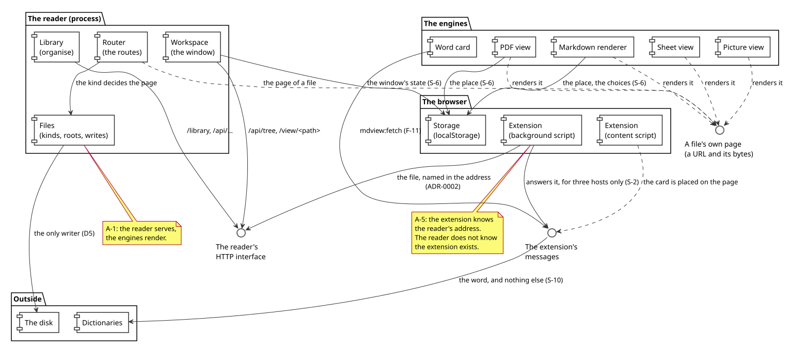
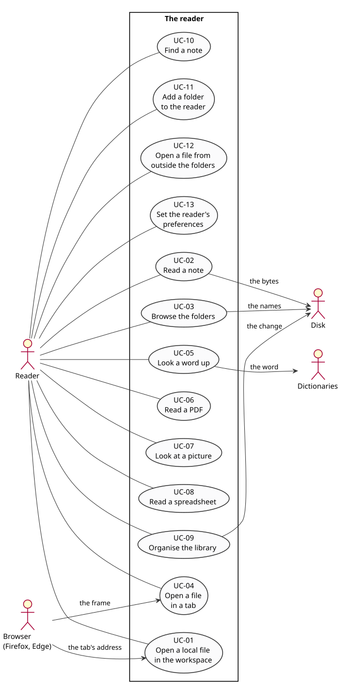
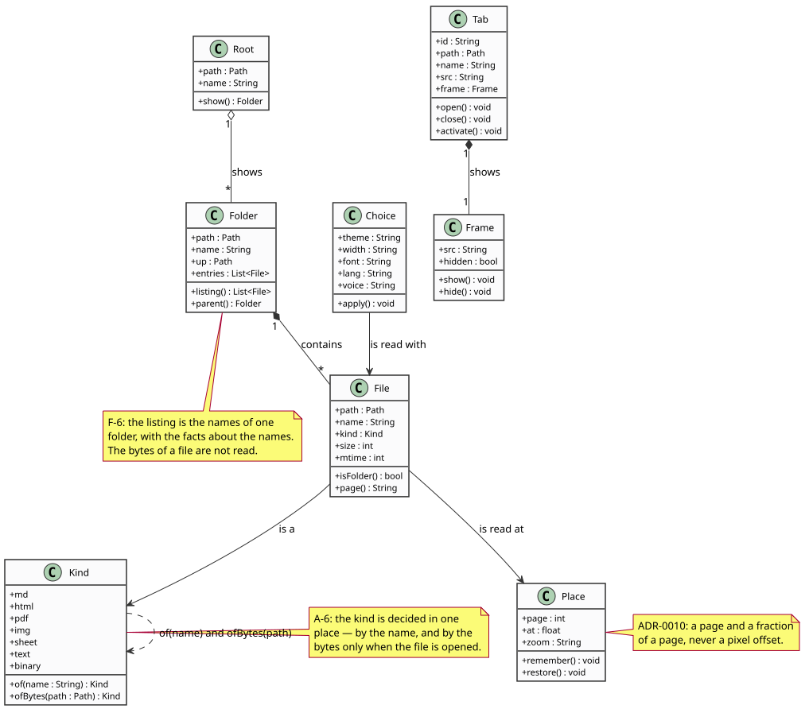

# 00 — Overview

What mdview is, the words it uses, and the principles the rest of the
specification obeys.

## 1. What it is

A reader for one person's notes, on one machine, that opens **every** file it
can and shows it well.

The system has two halves that meet over HTTP on the loopback:

* **the extension** (a Firefox add-on) notices the files the browser opens and
  sends them to the reader;
* **the reader** (a local server) holds the folders, serves the pages, and is
  the only thing that writes to the disk.

Inside the reader there are **engines**: a renderer for markdown, a view for
PDFs, a view for pictures, a view for spreadsheets, and a card for looking a
word up. An engine is given a URL and renders what is at it. The reader knows
nothing about how a document is drawn, and an engine knows nothing about the
reader.

## 2. The vocabulary

| Word | What it means here |
|---|---|
| **the reader** | The local server, and by extension the whole app: the window, the folders and the engines it serves. |
| **the workspace** | The reader's home page: the folders on the left, the open files along the top, the document in the middle. |
| **the library** | The other half of the window: folders as cards, notes as rows, and the tools to organise them. |
| **a file** | Anything on the disk the reader is asked to show. |
| **a kind** | What the reader makes of a file: `md`, `html`, `pdf`, `img`, `sheet`, `text` or `binary`. |
| **a root** | A folder the reader shows. The list is in `roots.json`. |
| **the tree** | The folders on the left of the workspace, browsed one folder at a time. |
| **a tab** | An open file in the workspace. Every tab is one of the reader's own pages. |
| **a frame** | The window a document is shown in. The workspace's tabs are frames; an HTML file's page holds one. |
| **the place** | Where the reader had reached in a document: a page and a fraction of a page. |
| **the card** | The small panel that shows a word's meanings, opened by double-clicking it. |
| **the desk** | The reader's own colouring: light, dark or warm. |

## 3. The principles

Each of these is a sentence, and each of them is checkable.

| | |
|---|---|
| **D1** | The reader serves; the engines render. Neither half knows how the other is drawn. |
| **D2** | The reader keeps the disk; the browser keeps the reader's choices and the reader's place. Nothing about the person who reads is written down anywhere else. |
| **D3** | The extension sends the file; it does not render it. What the reader shows is what the reader's own pages show. |
| **D4** | Every kind of file is opened. A file with no engine of its own is its own text. |
| **D5** | The reader is the only writer. Every change goes through it, and every write carries the reader's own token. |
| **D6** | Degrade, never stall: a file the reader cannot show says so and offers the way forward; it is never refused without one. |
| **D7** | The measure is the proof. A claim about the reader's speed, its memory or its renderer is a number with a method, not an adjective. |
| **D8** | One seam, one address. The extension and the reader meet at exactly one URL, and everything else is a page of the reader's own. |

## 4. The rule families

The rules the rest of the specification states are numbered, and the numbers
are cited in the flows, in the stories and in the model. One prefix, one family.

| Prefix | Family | Where |
|---|---|---|
| `P-` | the reader's interface: the routes, the paths, the writes | [02-interfaces.md](02-interfaces.md) |
| `F-` | the features: what each kind of file becomes, and what the window does | [03-features.md](03-features.md) |
| `S-` | the security and the privacy | [04-security.md](04-security.md) |
| `Q-` | the quality: the gates, the measurements, the definition of done | [05-quality.md](05-quality.md) |
| `A-` | the architecture: the layers and the rules between them | [01-architecture.md](01-architecture.md) |

## 5. The shape of the system

```
   the browser (Firefox, Edge)
   ┌────────────────────────────────────────────────────────┐
   │  the extension            the reader's pages            │
   │  ┌──────────┐            ┌───────────────────────────┐  │
   │  │ background│  ──HTTP──▶│  the reader (127.0.0.1)   │  │
   │  │  script   │            │  ├── /            workspace│ │
   │  └──────────┘            │  ├── /view/…      a file  │ │
   │  ┌──────────┐            │  ├── /library     organise │ │
   │  │ content   │◀──pages──│  ├── /api/tree    folders │ │
   │  │  script   │            │  ├── /f/…         bytes   │ │
   │  └──────────┘            │  └── /static/…    engines  │ │
   │                          └───────────────────────────┘  │
   └────────────────────────────────────────────────────────┘
```

The extension is on the left: it watches the tabs, it sends the files, and it
looks words up on pages it does not own. The reader is on the right: it serves
the pages, and it holds the only handle on the disk.

The arrows are the whole interface: one HTTP conversation from the extension to
the reader, and one way back — the pages.

The same thing, drawn:



*The components, and the interfaces between them. The extension knows the
reader's address; the reader does not know the extension exists (A-5). The
reader's pages carry the token, and the card asks the background script and
never the dictionary (ADR-0007).*

The goals, and who has them:



*The four actors against the thirteen use cases. The reader is the only one
that wants anything; the browser, the dictionaries and the disk answer.*

And the words they use:



*The vocabulary: a root, a folder, a file, a kind, a tab, a place, a choice.
The kind is decided in one place, by the name and — only when a file is opened
— by the bytes (A-6).*

## 6. Where the rest of this is

| Question | Document |
|---|---|
| What must it do? | [../analysis/requirements.md](../analysis/requirements.md) |
| What is a body of work? | [../analysis/epics.md](../analysis/epics.md) |
| What is a slice of work? | [../analysis/stories.md](../analysis/stories.md) |
| What is next? | [../analysis/backlog.md](../analysis/backlog.md) |
| How is it shaped? | [01-architecture.md](01-architecture.md) |
| What goes over the wire? | [02-interfaces.md](02-interfaces.md) |
| What does each kind of file become? | [03-features.md](03-features.md) |
| What is refused, and why? | [04-security.md](04-security.md) |
| How do we know it works? | [05-quality.md](05-quality.md) |
| Why is it like this? | [../decisions/](../decisions/) |
| What does it look like? | [../model/](../model/) |
| How do I run it? | [../operations/](../operations/) |
