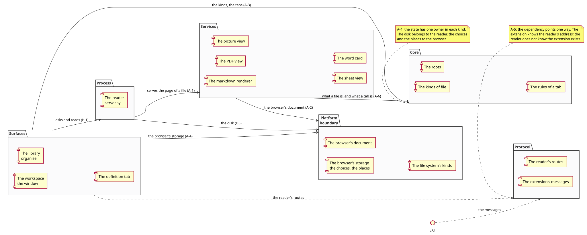
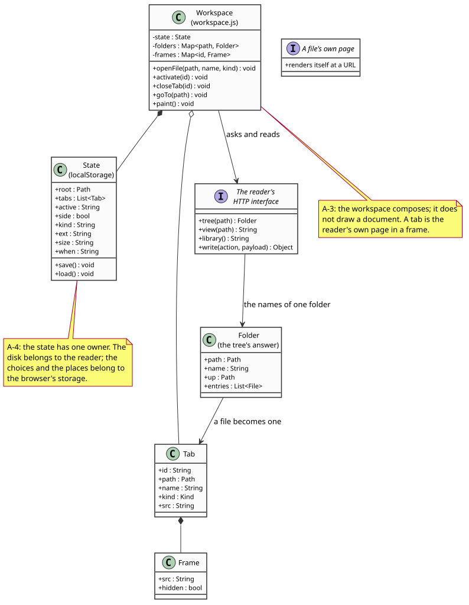

# 01 — Architecture

The layers, the rule between them, the process model and the platform
boundary.

## 1. The layers

The method's layers, filled in for this system:

```
  protocol / wire types     the reader's routes and the extension's messages
  core / domain             the kinds of file, the roots, the rules of a tab
  platform boundary          the browser's storage, the browser's storage of the
                             reader's choices, the file system's own kinds
  services (pipelines)       render: markdown → document; pdf → paint + text;
                             picture → pixels; workbook → grid
  process                   the reader: owns the disk, serves the surfaces
  surfaces                  the workspace, the library, the definition tab
```

The rule between them is the architecture (Cockburn, *Hexagonal Architecture*;
Evans, *Domain-Driven Design* for the bounded contexts): **a layer may only
depend on the layers above it.**

In this system the layers are not crates but directories, and the rule is
checkable by looking at what each file imports and fetches:



*The layers, in the order they may depend on each other: a layer may only
depend on the layers above it. The surfaces ask; the reader serves; the
engines render; the core says what a file is and what a tab is (A-1, A-6).*

| Layer | Files | What it may reach |
|---|---|---|
| The reader (the process) | `reader/server.py`, `workspace.js`, `workspace.css`, `text.css`, `imageview.js`, `imageview.css` | the disk, the browser's storage, its own pages |
| The engines (the services) | `~/mdview/extension/mdview.js`, `pdfview.js`, `sheet.js`, `lookup.js`, `mdview.css`, `lookup.css` | a URL, and the browser |
| The extension (the surface) | `~/mdview/extension/refresh.js`, `define.js` | the reader's address, and the browser's own APIs |
| The protocol | the routes in [02-interfaces.md](02-interfaces.md), the messages in [02-interfaces.md](#3-the-extension%E2%80%99s-own-messages) | — |

**Rule A-1** — the reader serves and the engines render. The reader must not
contain a line of document rendering, and an engine must not contain a line of
the reader's routing, its roots or its token.

**Rule A-2** — an engine is given a URL and renders what is at it. The engines
are served at `/static/…` and are used by the reader's pages and by the
extension's own pages alike; neither of those two callers is named in the
engine.

**Rule A-3** — the workspace composes; it does not draw. A tab in the workspace
is one of the reader's own pages in a frame, so a PDF in a tab is the same page
the reader serves on its own.

**Rule A-4** — the state has one owner in each kind. The disk is owned by the
reader: nothing else writes to it. The reader's choices and the reader's place
are owned by the browser's storage: nothing else keeps them.

**Rule A-5** — the dependency points one way. The extension knows the reader's
address; the reader does not know the extension exists. The reader serves any
browser that asks.

**Rule A-6** — the file kinds are decided in one place. The reader's `kind_of`
decides what a file is by its name, and its `file_kind` decides by its bytes
when the name is not enough. The workspace, the library and the extensions ask
the reader; they do not keep their own list.

## 2. The process model

Three questions, asked before the code was written.

### Who owns the state?

Two kinds of state, and each has exactly one owner.

| The state | The owner | Why there |
|---|---|---|
| The folders, the files, the names, the roots | **the disk**, reached only through the reader | A file is the truth about a note. A copy of it would go stale. |
| The open files, the place reached, the reader's choices | **the browser's storage** | The reader is restarted by systemd; the place in a note must survive that. The browser is the only store that outlives it. |



*The objects the workspace holds: its state, the tree's answer, a tab and its
frame. The state has one owner — the browser's storage — and the workspace
reads it and writes it back in one place, so that what is on screen and what
is stored cannot disagree (A-4).*

The workspace keeps no state of its own beyond what it reads from the browser's
storage, and it writes it back in one place (`save()`), so that what is on
screen and what is stored cannot disagree.

### What is the interface between the owner and the surfaces?

The reader's HTTP interface: a request/response interface on the loopback, with
the rules in [02-interfaces.md](02-interfaces.md). The reader's state is the
truth; a surface asks and reads; a refused command says why.

### What survives the interface being closed?

The reader, and the disk. Closing the window loses the tabs — they are the
browser's memory of the window — and loses nothing else: the files are still
there, the place in each is still in the browser's storage, and the reader goes
on serving.

## 3. The platform boundary

The platform here is the browser, and the boundary is narrow: the browser's
storage, the browser's tabs and menus, and the file system's own kinds of file.
The reader is written against those, and the engines are written against the
browser's document.

There is no trait to draw here, and pretending otherwise would be a lie: the
system runs in exactly one platform, on exactly one machine, for exactly one
person. What the method's rule asks for — *the platform's own quality features
are checked before a mechanism is invented for them* — is answered by the
engine's own code: the browser's storage is used because it is the only thing
that survives the reader's restart, and the browser's own PDF and picture
rendering is not used because the reader has better ones.

Two platform features are worth naming, because using them saved work:

* **the browser's own find-in-page** reads the text layer the PDF view lays
  over the paint, so the reader did not have to write a search for PDFs;
* **the browser's own scrolling** moves a document that is taller than the
  window, so the workspace's frames scroll for free.

## 4. The read path, end to end

The path a local `.md` file takes from the browser to a rendered document:

1. The browser opens the file at its `file://` address.
2. The extension's background script sees the address and writes the reader's
   address into the tab (`/?open=<path>`).
3. The workspace reads the path from its address, asks the reader for the
   folders around it, and asks the reader for the file's page.
4. The reader answers with the file's own page — a small shell that fetches the
   bytes from `/f/<path>` and hands them to the renderer.
5. The renderer parses the note and builds the document; the page's own text
   layer is laid over it so a word can be chosen.
6. The page asks the background script for a word's meanings when the reader
   double-clicks one.

Every step crosses the reader's HTTP interface except the last, which crosses
the extension's message interface.

## 5. The write path

1. The library or the workspace posts a change to `/api/…`.
2. The reader checks the origin and the token (S-1).
3. The reader checks that the change is inside one of its roots.
4. The reader makes the change on the disk and answers.
5. The page reloads, and the listing is what is on the disk.

There is no other way to write. The extension never writes; the engine never
writes; the browser's storage is the reader's own, under its own key.

## 6. What the architecture cannot decide

* **Whether a feature is worth it** — the backlog's job
  ([../analysis/backlog.md](../analysis/backlog.md)).
* **What the browser does with a file** — the evidence's job
  ([../analysis/evidence.md](../analysis/evidence.md)): Firefox decides that a
  `.xlsx` is not something it can show, and hands it to an application.
* **How the pieces are named** — the vocabulary above, and the code.
