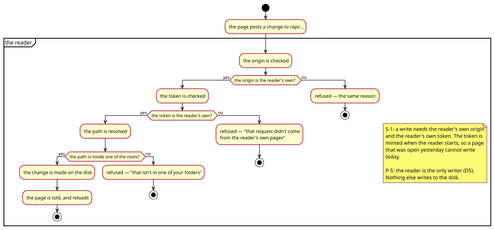

# 04 — Security and privacy

What the reader refuses, what it keeps, and what it sends away. The rules
here are numbered `S-` and are cited by the flows in
[../analysis/use-case-descriptions.md](../analysis/use-case-descriptions.md) and
by the features in [03-features.md](03-features.md).

The system runs on one machine, for one person, on the loopback. That is not
an excuse for care: a browser on the same machine is a stranger's code as far
as the reader is concerned, and the reader writes to the disk.

## 1. The write boundary

The reader writes to the disk. Anything that can reach the reader's address
can therefore try to write to the disk, and a page on any site the reader
visits can make a request to `127.0.0.1:8765` — the browser will not stop it,
because that is what a page is allowed to do.

*The write, and the two refusals before it: the origin, and the token. The
third is the reader's own rule — the change has to be inside one of its roots
(S-1, P-5).*

**Rule S-1** — a write is refused unless it carries the reader's own origin
*and* the reader's own token. The origin is one of the reader's three
addresses; the token is minted when the reader starts, is put in the head of
every page the reader serves, and is compared in constant time. A page the
reader did not serve cannot know the token: it is not in the page's source
unless the reader put it there, and the reader only puts it in its own pages.

**Rule S-2** — the host allow-list. The background script fetches only
`api.dictionaryapi.dev`, `api.datamuse.com` and `en.wiktionary.org`, and it
checks the URL before it makes the request, not after. The extension's
manifest declares those three hosts and nothing else.

**Rule S-3** — the dictionary requests leave through the background script.
A page's own `fetch` is the *page's* fetch: subject to the page's rules and to
whatever the dictionary's headers say, on an origin where getting either wrong
is silent. From the background script the request carries the add-on's
permissions and neither applies.

**Rule S-4** — a note cannot run script. The renderer does not pass raw HTML
through: only a presentational allow-list of tags survives, with the
attributes whitelisted, the URL schemes restricted and the style declarations
filtered. Everything else is escaped, so a note in a `file://` origin cannot
reach the files beside it.

## 2. What the reader keeps

**Rule S-5** — the reader keeps nothing about the person who reads. The
choices and the place are in the browser's storage, under the reader's own
keys; the reader's own memory holds the folders it was told about and a list
of names it is indexing. There is no account, no log of what was read, and
nothing is sent anywhere.

**Rule S-6** — the state lives in the browser's storage and nowhere else:
`mdview:theme`, `mdview:reading-width`, `mdview:font`, `mdview:define`,
`mdview:lang`, `mdview:say`, `mdview:read:<url>` for the place in a document,
`mdview:pdf:<url>` for the place in a PDF, `mdview:recent` for the files that
were opened, and `mdview:workspace` for the window's own state. A browser
that refuses to keep them (a private window) still shows everything; it just
does not remember it.

## 3. What the reader serves

**Rule S-7** — the reader serves only what it is asked for, from the folders it
was told about, and only to the loopback. A path that resolves outside those
folders is refused with a page that names the reason (F-8), and the file's
bytes are not served.

**Rule S-8** — the static route serves only the files on the allow-list. The
engine's scripts and styles come from one folder and the reader's own from
another; a name with a `..` in it never escapes, and a name that is not on
the list is not found (P-6).

**Rule S-9** — the reader's pages carry the token and nothing else of the
browser's. The token is in a `<meta>` in the head of the reader's own pages,
so that a page the reader did not serve cannot read it.

## 4. What the reader sends away

**Rule S-10** — nothing leaves the machine except the three dictionary
requests, and those carry the word and nothing else: no cookies, no
credentials, no referrer, and the answer is not cached (P-11).

## 5. The threats, and what answers them

| Threat | What answers it |
|---|---|
| A page on the internet writes to the reader | S-1: the origin and the token |
| A page on the internet reads the reader's folders | S-1, S-7: the reader answers the routes it has and refuses the rest; the cross-origin response cannot be read either |
| A note runs script and reaches the files beside it | S-4: the allow-list and the escaping |
| The reader becomes a proxy for the internet | S-2, S-10: the host allow-list, and no other outbound request |
| A dictionary host learns who is reading | S-10: the request carries the word and nothing else |
| The extension's own permissions are broader than the reader needs | S-2: three dictionary hosts and `file:///*` |
| The reader's own pages leak the token | S-9: the token is only in the pages the reader serves |
| A second person uses the reader | S-5: there is nothing of the first person's to find |

## 6. What is not covered

Written down, because a security section that hides its gaps is a decoration.

* **The token is in the page.** A page the reader serves carries it, and the
  reader's pages are same-origin with the reader's API, so a script injected
  into a *note* could reach it — but a note cannot run script (S-4). A
  compromise of the reader's own page would be a compromise of the reader.
* **The origins are checked, not the referrer.** A page on `localhost:8765`
  that is not the reader would pass. There is one such address and it belongs
  to the reader.
* **The extension's `file:///*` permission is broad.** It is what lets the
  extension see the address of a local file, which is all it uses it for.
* **Nothing has been attacked.** The rules above are reasoned, not tested
  against an attacker. There is no test that tries to write without the token
  from a foreign origin — the interface suite checks the missing token, and
  nothing checks the missing origin or a page from another site.
